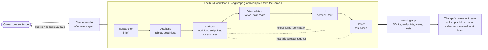
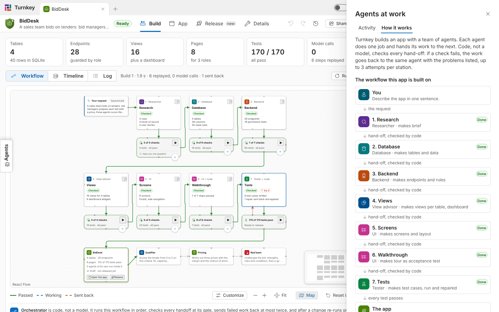
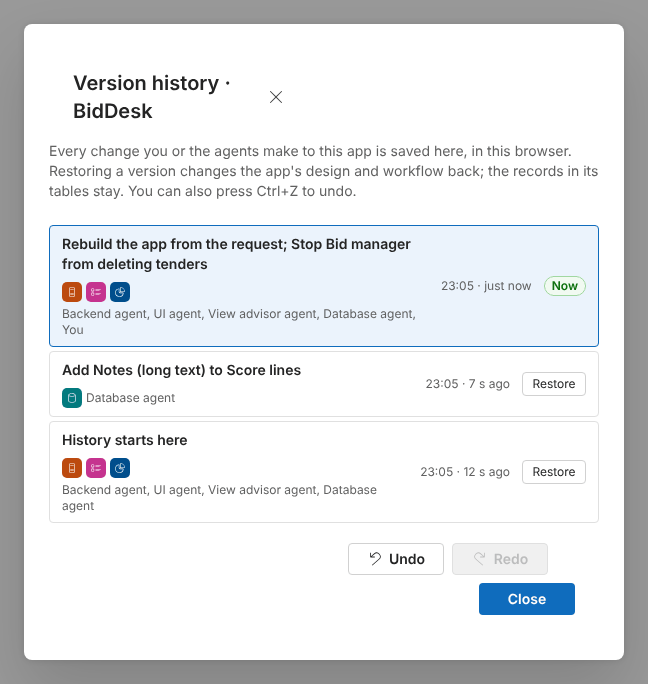

# Turnkey

Describe the app your work needs in one sentence. A team of agents builds its database, backend rules, views, pages
and tests on a workflow you can watch and change, checks each other's work, and hands it over as a working app.
Solo entry for the SSI Agent-A-Thon 2026.

**Live app:** https://turnkey-bay.vercel.app/ (no login; **Demo** replays saved builds and calls no model)


_From one sentence to the running app, played at twice its speed. In Demo the sentence picks the closest saved build, so no model is called._

## See it in 60 seconds

1. Open the live app, press **Get started**, choose **Skip and use the demo account**, keep **Demo**, pick **Sales
   bidding desk**.
2. Watch the **Build** tab: six agents hand work to each other, a check runs after each, the Tester catches a planted
   slip and the Backend agent repairs it. Open **Agents** (activity panel) to see every step, tool call and hand-off.
3. Open the **App** tab: the app it built, with its own sign-in per role, and a **Bid room** where the app's own three
   agents work on a tender.


_The Build tab after the build. Each agent is a node and each check is a gate under it. The chat on the right holds the agents' cards and suggested changes._

A longer walk-through is below, and the three-minute demo script is in
[`docs/hackathon/demo-video.md`](docs/hackathon/demo-video.md).

## How the agents work together

Five builder agents and a Tester, each with one job: **Researcher** (brief), **Database** (tables and seed rows),
**Backend** (workflow, endpoints, access rules), **View advisor** (views and dashboard), **UI** (screens and tour) and
**Tester** (test cases). The owner's workflow on the canvas is compiled into a LangGraph graph, and that graph runs
the build. Code, not a model, decides whether each answer is good enough:

- **Hand-off.** Each agent gets the checked output of the agents before it.
- **Check and send back.** After every station, code applies the answer (creates the tables, calls every endpoint as
  every role, draws every view and screen) and checks it. A failure goes back to the same agent with the failures in
  its next prompt, three attempts at most, then a safe built-in default or a clear stop.
- **Repair from tests.** The Tester writes test cases from the brief; code plays them; a failing test goes back to the
  Backend agent, whose fix must pass the same checks as any change. An app is ready only when its tests pass.
- **The owner decides.** The Researcher asks when the brief has a real trade-off, the owner can put approval gates
  after any station, add review agents or their own agents to the line, and a change that deletes data waits for a
  yes. Editing the workflow re-runs only the stations it touches.
- **Visible.** Every step is an AG-UI event: the canvas, the timeline, the log, the Agents panel and debug mode all
  read the same stream, and each table, field and screen shows which agent made or last changed it.

In **Live**, each agent's turn runs on the server as a small LangGraph graph (draft, check the JSON against the
role's schema, repair, at most three model calls) behind the CopilotKit runtime, streamed to the browser over AG-UI.



The full sequence of a build, one agent step on the server, a team run, a change from chat and the release pipeline
are in [`docs/architecture/overview.md`](docs/architecture/overview.md).



_The Agents panel explains the team in the app itself; its Activity tab lists every step, tool call and hand-off as it happens._


_The Tester's first run fails one case (a bid manager could delete a tender); the Backend agent repairs it and run 2 passes._

<table>
  <tr>
    <td width="50%"></td>
    <td width="50%"></td>
  </tr>
  <tr>
    <td><em>A change from chat. The Orchestrator shows its plan as a card; only the stations the change touches run again.</em></td>
    <td><em>An approval the owner placed after Views. The build waits on the canvas and in chat until the owner answers.</em></td>
  </tr>
  <tr>
    <td></td>
    <td></td>
  </tr>
  <tr>
    <td><em>The run timeline, one lane per agent. The line on top gives the model calls, tokens and cost; a saved build spends nothing.</em></td>
    <td><em>Version history. Every change is a version that names the agents or the person who made it.</em></td>
  </tr>
</table>

## What it builds

Nine saved builds come with the app, each a separate working app. Six have their own agent team inside: the three
suggested quests, Fact-check desk (Extractor, Researchers, Verifier), Prior-art scout (Search, Analyst, Critic) and
Debate partner (For, Against, Moderator), plus Sales bidding desk (Qualifier, Pricing, Red team) and Grant review desk
(Assessor, Budget reviewer, Due diligence). The others are plain business apps: clinic appointments, IT helpdesk,
leave requests and purchase requests. In Live, a team runs on the server as a LangGraph graph: agents in order,
lookups in Wikipedia, World Bank, OpenAlex, arXiv or PatentsView where the agent has the tool, a check after each
agent that can send the work back once, and a pause where a person adds a point. Where a team could be used:
[`docs/hackathon/use-cases.md`](docs/hackathon/use-cases.md).


_The Bid room of the built BidDesk app, with the three agents' verdict for one tender. All data is made up._

## The five-minute walk-through

1. Open the live app and press **Get started**. Choose **Skip and use the demo account**, keep **Demo** selected (it
   replays saved builds and calls no model), pick **Sales bidding desk** as the first app, and open the workspace.
2. Watch the **Build** tab. Each agent is a node with a check gate under it. The Tester's first run catches the
   Backend agent's slip (a bid manager could delete a tender), the Backend repairs it, and run 2 passes all 170 tests.
   The build takes about 30 seconds. Switch between **Workflow**, **Timeline** and **Log** to see the same run three
   ways, and open **Agents** on the left edge for every step, tool call and hand-off.
3. Open the **App** tab and sign in as Sana Malik (bid manager), then as Omar Farooq (sales director) from **Preview
   as**: each role sees only what its rules allow. In the **Bid room**, pick **Port fleet tracking** and press **Run
   the agents**. The Qualifier scores it, Pricing prices it, and the run stops for you to add a condition before the
   Red team gives its verdict.
4. In the chat sidebar, press **Add a notes field to score lines** (or type a change). The Orchestrator shows a plan,
   only the stations the change touches run again, and the tests are regenerated.
5. Open **Release**, release version 1.0 (every test runs first), and press **Share by link**. Turn on debug mode
   (bug icon in the title bar) to see AG-UI events, tool calls, SQL and model usage.


_The Release tab. One deliverable document is made from the app as it is now, in each format._

To see Live agents build from your own words, switch **Live** on in the title bar and type a sentence on a new tab.
Each Live session is capped at 40 model calls.

## What is in it

- **Workspace:** workflow canvas, timeline and log; Agents panel and a "How it works" page; chat sidebar with the
  agents' cards; 14 view types and dashboards in the built apps; releases with a test gate; share by short link;
  install a built app under its own name and icon; works offline for saved builds; phone and tablet layouts; Fluent 2
  UI (`@fluentui/react-components` v9); first-run guide.
- **Data:** each app's SQLite database (sql.js) and the workspace live in the browser's IndexedDB, with backup and
  restore, and export and import of an app's `.sqlite` file. Nothing about an app is kept on the server, except a
  shared app saved under a short link.
- **Server:** `/api/copilotkit` (CopilotKit runtime, AG-UI agents `step` and `team`), `/api/agent/team` (team runs as
  server-sent AG-UI events), `/api/llm`, `/api/connectors/<name>`, `/api/share`, `/api/health`. A model gateway for a
  Claude API key, LiteLLM, any OpenAI-compatible service, the Claude Code CLI (local only) and a stand-in for tests,
  with effort per tier, prompt caching and a cost line per call.
- **Guard rails:** only Turnkey's own agent prompts are relayed; per-visitor and global rate limits; a daily call cap
  and a daily dollar cap; 40 model calls per Live session; `LIVE_MODE=off` switch; cross-site calls refused. See
  [Budget](#budget).
- **Checks:** unit tests (vitest) and 12 browser flows in CI (Playwright), including accessibility (axe), phone and
  tablet sizes and offline; a smoke test of the live site after each release.

The app's About dialog ("What is real in this prototype") says what Demo replays and what Live does for real.

## Budget

The model budget is small and does not refill, and it also covers judging. Demo needs no model at all. In Live,
`src/server/guard/limits.ts` caps calls at 20 per visitor and 50 for everyone per minute, 600 a day and 5 dollars a
day (priced from the tokens each call used), and the workspace stops a session after 40 model calls. Quick steps use
the cheaper model tier. `/api/health` shows the calls and the spend so far.

## Submission summary

> Turnkey turns one sentence into a working business app: SQLite database, role-guarded backend, views, pages and tests. Five builder agents and a Tester run on a LangGraph workflow the owner can watch and edit, and every step streams over AG-UI. Code checks each handoff and sends failed work back, failing tests go back to the Backend for repair, and the owner approves big trade-offs. Built apps get agent teams of their own that look up public sources: fact-check, prior-art, debate, bidding, grant review. Demo mode needs no model.

(Counted: 534 characters.) Evidence for each rule and criterion: [`docs/hackathon/criteria.md`](docs/hackathon/criteria.md).

## More documents

- [`docs/architecture/overview.md`](docs/architecture/overview.md): diagrams of how it is built
- [`docs/adr/`](docs/adr/README.md): the ten design decisions and why
- [`docs/architecture/ag-ui.md`](docs/architecture/ag-ui.md): how agents stream their steps over AG-UI
- [`docs/hackathon/submission.md`](docs/hackathon/submission.md): what goes into the submission form
- [`docs/hackathon/demo-video.md`](docs/hackathon/demo-video.md): the demo video script and shot list
- [`docs/hackathon/criteria.md`](docs/hackathon/criteria.md) and [`use-cases.md`](docs/hackathon/use-cases.md)
- [`docs/PLAN.md`](docs/PLAN.md): the build plan and who owns which folders
- [`docs/RUNBOOK.md`](docs/RUNBOOK.md): how agents work on this repository in parallel

## The two pages

- **Workspace** at `/`: the full product. It runs on saved builds with no model configured, and on live agents
  once a model key is set on the server. A shared app saved under a short link opens at `/<name>`.
- **Spike** at `/spike`: one streamed tool call from the model that updates shared canvas state, through CopilotKit
  (AG-UI) and LiteLLM. Kept as the proof that the stack works end to end.

## Run it

```bash
npm ci
npm run dev                      # http://localhost:3000, saved builds only
LLM_PROVIDER=mock npm run dev    # a stand-in model: no key, no network, no cost
LLM_PROVIDER=claude-code npm run dev  # your local Claude Code login (development only)
```

To use a real model, copy `.env.example` to `.env.local` and fill in one backend. On Vercel, set the same names under
Settings → Environment Variables, then cut a release (merges do not deploy; see
[`docs/process/deploy.md`](docs/process/deploy.md)).

| Backend                        | Names                                                                                              |
| ------------------------------ | -------------------------------------------------------------------------------------------------- |
| Claude API key (the live site) | `ANTHROPIC_API_KEY`; optional `ANTHROPIC_MODEL`, `ANTHROPIC_MODEL_FAST`                            |
| The SSI LiteLLM gateway        | `LITELLM_BASE_URL` (with `/v1`), `LITELLM_API_KEY`, `LITELLM_MODEL`; optional `LITELLM_MODEL_FAST` |
| Any OpenAI-compatible service  | `OPENAI_API_KEY`, `OPENAI_MODEL`; optional `OPENAI_MODEL_FAST`, `OPENAI_BASE_URL`                  |

`LLM_PROVIDER` forces one; otherwise the first that is set is used, in the order above. Details:
[`src/server/llm/README.md`](src/server/llm/README.md). Keys are read only by server code. Never commit one, never put
one in a `NEXT_PUBLIC_` variable.

Check a deployment:

| Address                   | Tells you                                                                                              |
| ------------------------- | ------------------------------------------------------------------------------------------------------ |
| `/api/health`             | the app is up, which backend answers, which commit is deployed, calls and spend so far. Costs nothing. |
| `/api/health?probe=1`     | one tiny model call: is the key accepted and the model name right                                      |
| `/api/health?probe=tools` | one tool call: can the configured model call tools, and which models the key can see                   |

## Check your work

```bash
npm run check                 # secrets scan, lint, typecheck, unit tests
npm run test:e2e -- demo      # one browser flow; CI runs all twelve
```

The README's pictures come from `scripts/readme-media.mjs`: start a production build (`npm run build`, then
`PORT=3333 npx next start`) and run `TK_URL=http://localhost:3333 node scripts/readme-media.mjs`. It needs ffmpeg, uses
Demo data only, and writes the PNGs and `demo.gif` (a sentence typed on Home, through the build, to the running app) to `docs/images/`.

## The spike

One streamed tool call from the model updates shared canvas state:

1. You type in the chat sidebar on `/spike`.
2. `src/app/api/copilotkit/[[...slug]]/route.ts` runs the Architect agent (CopilotKit `BuiltInAgent`, in process)
   against LiteLLM's OpenAI-compatible endpoint (`src/lib/model.ts`).
3. The model calls the frontend tool `add_canvas_node` (fixed catalog of node kinds, `src/lib/canvas.ts`).
   Its arguments stream over AG-UI to the browser.
4. The browser adds the node to the canvas, mirrors it into AG-UI shared state, and saves it to localStorage.

## Layout

```
src/app/(workspace)  the workspace page, and /<name> for short links
src/app/(spike)      the spike page
src/app/a            per-app web manifest and icon, for installing a built app
src/app/api          routes: copilotkit (AG-UI), agent/step, agent/team, llm, connectors, share, health
src/workspace        the workspace UI: React modules with JSX
src/platform         browser side: workflow graph (orchestrator), AG-UI client, model client, storage, PWA, sql.js
src/server           server only: model gateway, agent graphs, agent schemas, AG-UI registry, connectors, guard rails, short links
src/shared           types and schemas used by both sides, the agent contract, SQL checks
tests/unit           vitest
tests/e2e            the browser flows
docs                 plan, architecture, decisions, hackathon evidence
.claude              agents, skills, rules and hooks for Claude Code
```
