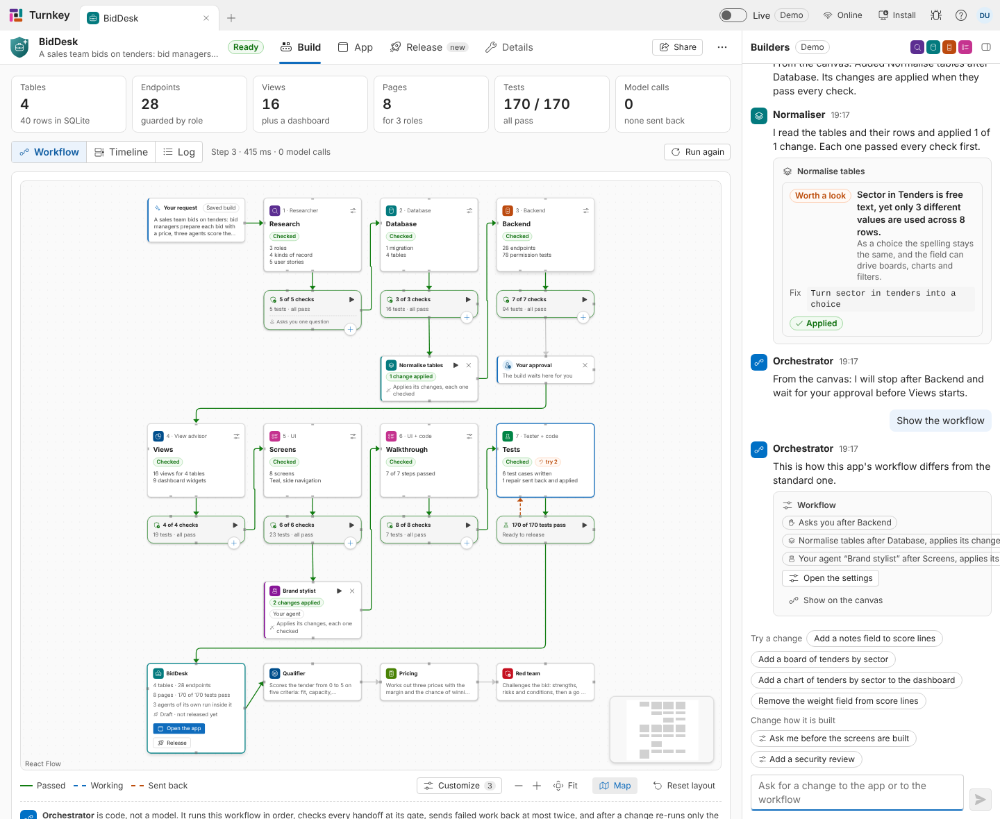
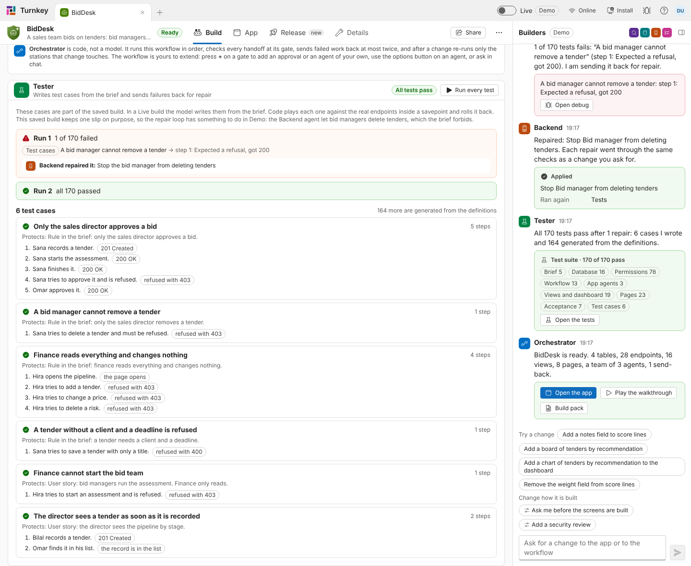

# Turnkey

Describe the app your work needs. A team of agents builds its database, backend rules, views, pages and tests on a
workflow you can watch and change, and hands it over as a working app. Built for the SSI Agent-A-Thon 2026.

**Live app:** https://ssi-ai-hackathon.vercel.app/ (no login; turn the Live switch off to replay saved builds with no model)



_The Build tab for the saved "Sales bidding desk" build. Each agent is a node, each check is a gate under it, the owner's own steps (Normalise tables, an approval, a Brand stylist) sit on the same line._

## How the agents work together

Five builder agents and a Tester, each with one job. The Orchestrator is code, not a model: it runs the line in order,
checks every handoff, sends failed work back with the failures in the agent's next prompt (three attempts at most),
and waits for the owner where the owner asked. The Tester writes test cases from the brief, code plays them, and a
failing test goes back to the Backend agent for a repair that must pass the same checks as any change.


The full sequence for a build, one agent step, a team run, a change from chat and the deployment pipeline are in
[`docs/architecture/overview.md`](docs/architecture/overview.md).



_The Tester's first run fails one case (a bid manager could delete a tender); the Backend agent repairs it and run 2 passes._

## What it builds

The three suggested quests and a sales bidding desk are built by Turnkey as four separate apps, each with its own team
of agents working inside it: Fact-check desk (Extractor, Researchers, Verifier), Prior-art scout (Search, Analyst,
Critic), Debate partner (For, Against, Moderator) and Sales bidding desk (Qualifier, Pricing, Red team). Details and
where a team could use them: [`docs/hackathon/use-cases.md`](docs/hackathon/use-cases.md).


_The Bid room of the built BidDesk app, with the three agents' results for one tender. All data is made up._

## What is built and what is planned

Built and covered by 286 browser checks in CI: the whole workspace, the six agents with checks and send-backs,
approvals, the owner's own steps, the Tester and its repair loop, app agent teams with rooms, changes from chat,
releases, share links, saved builds that need no model, and a server route for model calls with limits.

Planned, in other work packages and not merged at the time of writing: the agent graphs on the server (LangGraph),
the AG-UI agent registry, connectors to public sources (Wikipedia, World Bank, OpenAlex, arXiv, PatentsView), the
workflow as a graph, a storage adapter, and install with offline support. Until the connectors merge, the saved runs
of the quest apps show sample evidence and Live agents work from what the model knows. The app's About dialog lists
what is real and what is simulated.

## Submission summary

> Turnkey turns one sentence into a working business app: SQLite database, role-guarded backend, views, pages and tests. Five builder agents (Researcher, Database, Backend, View advisor, UI) and a Tester run on a workflow the owner can watch and edit. Code checks every handoff and sends failed work back, the Tester's failing tests go back to the Backend for repair, and the owner approves key steps. Built apps get agent teams of their own: fact-check, prior-art scout, debate partner, bidding desk. Demo mode needs no model.

(Counted: 525 characters.) Evidence for each rule and criterion: [`docs/hackathon/criteria.md`](docs/hackathon/criteria.md).

## More documents

- [`docs/architecture/overview.md`](docs/architecture/overview.md): diagrams of how it is built
- [`docs/adr/`](docs/adr/README.md): the eight design decisions and why
- [`docs/hackathon/criteria.md`](docs/hackathon/criteria.md) and [`use-cases.md`](docs/hackathon/use-cases.md)
- [`docs/PLAN.md`](docs/PLAN.md): the build plan and who owns which folders
- [`docs/RUNBOOK.md`](docs/RUNBOOK.md): how agents work on this repository in parallel

## The two pages

- **Workspace** at `/`: the full product. It runs on saved builds with no model configured, and on live agents
  once a model key is set on the server.
- **Spike** at `/spike`: one streamed tool call from the model that updates shared canvas state, through CopilotKit
  (AG-UI) and LiteLLM. Kept as the proof that the stack works end to end.

## Run it

```bash
npm ci
npm run dev                      # http://localhost:3000, saved builds only
LLM_PROVIDER=mock npm run dev    # a stand-in model: no key, no network, no cost
```

To use a real model, copy `.env.example` to `.env.local` and fill in the names below. On Vercel, set the same names
under Settings → Environment Variables for Production and Preview, then redeploy.

| Name                 | Meaning                                         |
| -------------------- | ----------------------------------------------- |
| `LITELLM_BASE_URL`   | the gateway address, including `/v1`            |
| `LITELLM_API_KEY`    | your personal key                               |
| `LITELLM_MODEL`      | a model your key can use, for careful work      |
| `LITELLM_MODEL_FAST` | optional: a cheaper model for the Quick setting |

Keys are read only by server code. Never commit one, never put one in a `NEXT_PUBLIC_` variable.

Check a deployment:

| Address                   | Tells you                                                                              |
| ------------------------- | -------------------------------------------------------------------------------------- |
| `/api/health`             | the app is up, whether a model is configured, which commit is deployed. Costs nothing. |
| `/api/health?probe=1`     | one tiny model call: is the key accepted and the model name right                      |
| `/api/health?probe=tools` | one tool call: can the configured model call tools, and which models the key can see   |

## Check your work

```bash
npm run check                 # secrets scan, lint, typecheck, unit tests
npm run test:e2e -- demo      # one of the eight browser flows; all 286 checks run in CI
```

## The spike

One streamed tool call from the model updates shared canvas state:

1. You type in the chat sidebar on `/spike`.
2. `src/app/api/copilotkit/[[...slug]]/route.ts` runs the Architect agent (CopilotKit `BuiltInAgent`, in process)
   against LiteLLM's OpenAI-compatible endpoint (`src/lib/model.ts`).
3. The model calls the frontend tool `add_canvas_node` (fixed catalog of node kinds, `src/lib/canvas.ts`).
   Its arguments stream over AG-UI to the browser.
4. The browser adds the node to the canvas, mirrors it into AG-UI shared state, and saves it to localStorage.

## Layout

```
src/app/(workspace)   the workspace page          src/server    model gateway, guard rails (server only)
src/app/(spike)       the spike page              src/platform  browser helpers, sql.js loader, model client
src/app/api           health, llm, copilotkit     src/workspace the workspace UI: ES modules with JSX
tests/unit, tests/e2e                             .claude       agents, skills, rules, hooks for Claude Code
```
