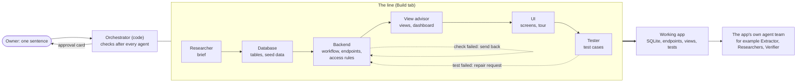
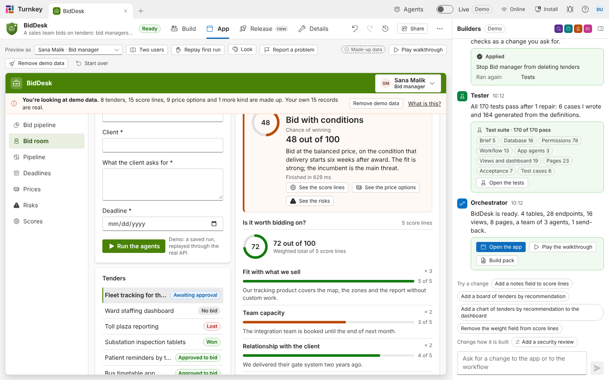

# Turnkey

Describe the app your work needs. A team of agents builds its database, backend rules, views, pages and tests on a
workflow you can watch and change, and hands it over as a working app. Built for the SSI Agent-A-Thon 2026.

**Live app:** https://ssi-ai-hackathon.vercel.app/ (no login; turn the Live switch off to replay saved builds with no model)


_The Build tab for the saved "Sales bidding desk" build. Each agent is a node, each check is a gate under it, the owner's own steps (Normalise tables, an approval, a Brand stylist) sit on the same line._

## How the agents work together

Five builder agents and a Tester, each with one job. The Orchestrator is code, not a model: it runs the line in order,
checks every handoff, sends failed work back with the failures in the agent's next prompt (three attempts at most),
and waits for the owner where the owner asked. The Tester writes test cases from the brief, code plays them, and a
failing test goes back to the Backend agent for a repair that must pass the same checks as any change.



The full sequence for a build, one agent step, a team run, a change from chat and the deployment pipeline are in
[`docs/architecture/overview.md`](docs/architecture/overview.md).


_The Tester's first run fails one case (a bid manager could delete a tender); the Backend agent repairs it and run 2 passes._

## What it builds

The three suggested quests and a sales bidding desk are built by Turnkey as four separate apps, each with its own team
of agents working inside it: Fact-check desk (Extractor, Researchers, Verifier), Prior-art scout (Search, Analyst,
Critic), Debate partner (For, Against, Moderator) and Sales bidding desk (Qualifier, Pricing, Red team). Details and
where a team could use them: [`docs/hackathon/use-cases.md`](docs/hackathon/use-cases.md).



_The Bid room of the built BidDesk app, with the three agents' results for one tender. All data is made up._

## Try it in five minutes

1. Open the live app. Leave **Live** off: Demo replays saved builds and calls no model.
2. On the home screen pick the saved build **Sales bidding desk** and press build. Watch the **Build** tab: each agent
   is a node, a check gate sits under each one, and the Backend agent's slip is caught by the Tester and repaired.
   Switch between **Workflow**, **Timeline** and **Log** to see the same run three ways.
3. Open the **App** tab and use the app it built: sign in as different roles and see the access rules hold. Open the
   **Bid room** and run its three agents on a tender.
4. In the chat sidebar, ask for a change ("add a notes field to tenders"). Only the stations it touches run again,
   and it rolls back if a check fails.
5. **Release** a version (its tests must pass) and **Share** it by link. Turn on **Debug mode** (bug icon in the title
   bar) to see events, tool calls and model usage.

## What is built and what is planned

Built and covered by 297 browser checks in 9 flows: the whole workspace, the six agents with checks and send-backs,
approvals, the owner's own steps, the Tester and its repair loop, app agent teams with rooms, changes from chat,
releases, share links, and saved builds that need no model. On the server: a model route with limits, a gateway with
five providers (LiteLLM, OpenAI-compatible, Anthropic, the Claude Code CLI for local use, a stand-in), and the health
route with model probes.

Built and tested but not yet on the path a build takes: the build workflow as a LangGraph graph compiled from the
owner's canvas (`src/platform/orchestrator`), the AG-UI agent registry in the CopilotKit runtime with a browser client
(`src/server/agui`, `src/platform/agui`), and connectors to Wikipedia, World Bank, OpenAlex, arXiv and PatentsView
(`src/server/connectors`).

Planned, in work packages not merged at the time of writing: each agent step and each app team as a LangGraph graph
on the server, wiring Live builds and quest apps through them, a storage adapter with backup and export, install with
offline support, and Fluent 2 controls throughout. Until the quest apps are wired to the connectors, their saved runs
show sample evidence and Live agents work from what the model knows. The app's About dialog lists what is real and
what is simulated.

## Submission summary

> Turnkey turns one sentence into a working business app: SQLite database, role-guarded backend, views, pages and tests. Five builder agents (Researcher, Database, Backend, View advisor, UI) and a Tester run on a workflow the owner can watch and edit. Code checks every handoff and sends failed work back, the Tester's failing tests go back to the Backend for repair, and the owner approves key steps. Built apps get agent teams of their own: fact-check, prior-art scout, debate partner, bidding desk. Demo mode needs no model.

(Counted: 525 characters.) Evidence for each rule and criterion: [`docs/hackathon/criteria.md`](docs/hackathon/criteria.md).

## More documents

- [`docs/architecture/overview.md`](docs/architecture/overview.md): diagrams of how it is built
- [`docs/adr/`](docs/adr/README.md): the ten design decisions and why
- [`docs/architecture/ag-ui.md`](docs/architecture/ag-ui.md): how agents stream their steps over AG-UI
- [`docs/hackathon/submission.md`](docs/hackathon/submission.md): what goes into the submission form
- [`docs/hackathon/criteria.md`](docs/hackathon/criteria.md) and [`use-cases.md`](docs/hackathon/use-cases.md)
- [`docs/PLAN.md`](docs/PLAN.md): the build plan and who owns which folders
- [`docs/RUNBOOK.md`](docs/RUNBOOK.md): how agents work on this repository in parallel

## The two pages

- **Workspace** at `/`: the full product. It runs on saved builds with no model configured, and on live agents
  once a model key is set on the server.
- **Spike** at `/spike`: one streamed tool call from the model that updates shared canvas state, through CopilotKit
  (AG-UI) and LiteLLM. Kept as the proof that the stack works end to end.

## Run it

```bash
npm ci
npm run dev                      # http://localhost:3000, saved builds only
LLM_PROVIDER=mock npm run dev    # a stand-in model: no key, no network, no cost
LLM_PROVIDER=claude-code npm run dev  # your local Claude Code login (development only)
```

To use a real model, copy `.env.example` to `.env.local` and fill in the names below. On Vercel, set the same names
under Settings → Environment Variables for Production and Preview, then redeploy.

| Name                 | Meaning                                         |
| -------------------- | ----------------------------------------------- |
| `LITELLM_BASE_URL`   | the gateway address, including `/v1`            |
| `LITELLM_API_KEY`    | your personal key                               |
| `LITELLM_MODEL`      | a model your key can use, for careful work      |
| `LITELLM_MODEL_FAST` | optional: a cheaper model for the Quick setting |

Anthropic (`ANTHROPIC_*`) and any OpenAI-compatible service (`OPENAI_*`) work too; see
[`src/server/llm/README.md`](src/server/llm/README.md). Keys are read only by server code. Never commit one, never put one in a `NEXT_PUBLIC_` variable.

Check a deployment:

| Address                   | Tells you                                                                              |
| ------------------------- | -------------------------------------------------------------------------------------- |
| `/api/health`             | the app is up, whether a model is configured, which commit is deployed. Costs nothing. |
| `/api/health?probe=1`     | one tiny model call: is the key accepted and the model name right                      |
| `/api/health?probe=tools` | one tool call: can the configured model call tools, and which models the key can see   |

## Check your work

```bash
npm run check                 # secrets scan, lint, typecheck, unit tests
npm run test:e2e -- demo      # one of the nine browser flows; all 297 checks run in CI
```

## The spike

One streamed tool call from the model updates shared canvas state:

1. You type in the chat sidebar on `/spike`.
2. `src/app/api/copilotkit/[[...slug]]/route.ts` runs the Architect agent (CopilotKit `BuiltInAgent`, in process)
   against LiteLLM's OpenAI-compatible endpoint (`src/lib/model.ts`).
3. The model calls the frontend tool `add_canvas_node` (fixed catalog of node kinds, `src/lib/canvas.ts`).
   Its arguments stream over AG-UI to the browser.
4. The browser adds the node to the canvas, mirrors it into AG-UI shared state, and saves it to localStorage.

## Layout

```
src/app/(workspace)  the workspace page
src/app/(spike)      the spike page
src/app/api          routes: health, llm, copilotkit (AG-UI), connectors
src/workspace        the workspace UI: ES modules with JSX
src/platform         browser helpers: sql.js loader, model client, AG-UI client, workflow graph (orchestrator)
src/server           server only: model gateway, guard rails, AG-UI registry, connectors
tests/unit           vitest
tests/e2e            the browser flows
docs                 plan, architecture, decisions, hackathon evidence
.claude              agents, skills, rules and hooks for Claude Code
```
