# Turnkey

Describe the app your work needs in one sentence. Turnkey asks you a few questions, shows you a plan in plain words,
and builds the app only when you press **Build it**: a team of agents makes its lists, rules, screens and tests, checks
each other's work, and hands it over as a working app with its own welcome for each person who uses it. After the
first build you can say what is wrong or missing at any time, get a plan first, and release the change as the next
version.

**Live app:** https://turnkey-bay.vercel.app/ (no login; **Demo** replays saved builds and calls no model)

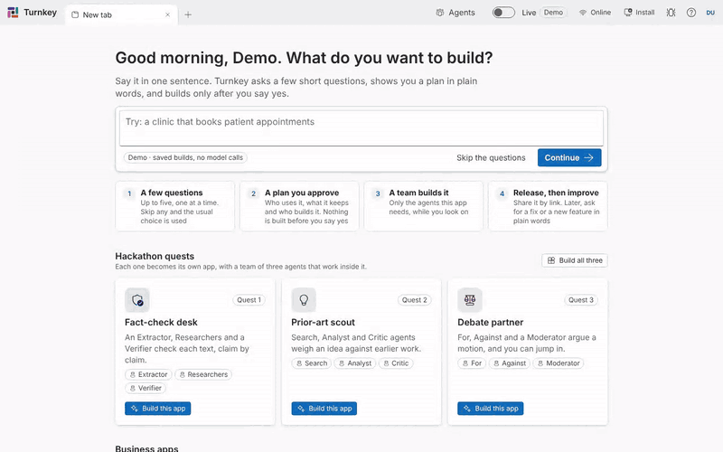

_From one sentence to the running app, played at twice its speed: question, plan, build, first use. In Demo the
sentence picks the closest saved build, so no model is called._

## See it in two minutes

1. Open the live app and press **Describe your own**. Type `A clinic books appointments for patients with its
doctors` and press Enter. (With **Live** off in the title bar this replays the saved clinic build and calls no
   model. With Live on, the Planner model writes the questions and the plan for your own sentence.)
2. **Questions.** The Planner says what it understood and asks one question at a time, each with a usual choice:
   "Should the front desk be able to read visit notes?", then whether you want demo data. The plan beside the cards
   fills in as you answer.
3. **The plan.** Who uses it, what it keeps, how an appointment moves, who can see and do what, and which agents will
   build it. Nothing is built until you press **Build it**.
4. **The build.** The Build tab shows one line per step and the agent doing it, turning from Working to Done. One
   part is sent back by the checks and fixed. All 142 checks pass. **Change something** beside Open the app takes you
   straight to the change box, before or after the first release.
5. **First use.** Open the **App** tab and sign in as Sara Malik: the app welcomes her as a receptionist, lists what
   she can do, and offers a one-minute tour. The made-up records are marked **Demo**; **Remove demo data** empties
   the lists in one step (and can be undone).
6. **Release and fix.** On **Release**, release version 1.0. Under "Something wrong, or something missing?", type or
   pick **Add a notes field to patients**. You get a plan first, the change waits in a draft that only you see, and
   after **It works** you release it as version 1.1. People with the link keep 1.0 until then. The Release page
   always offers the next version: with nothing changed it explains how, and **Release again without changes** asks
   only for a reason.

<table>
  <tr>
    <td width="50%">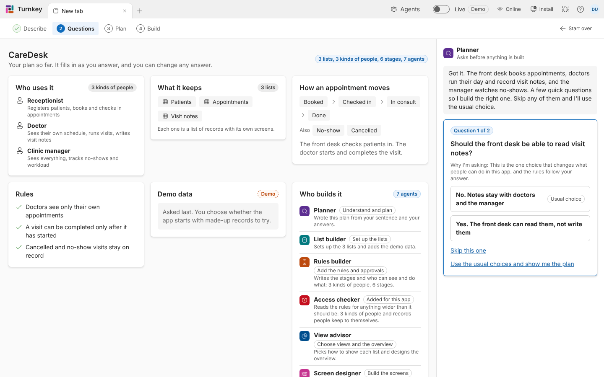</td>
    <td width="50%">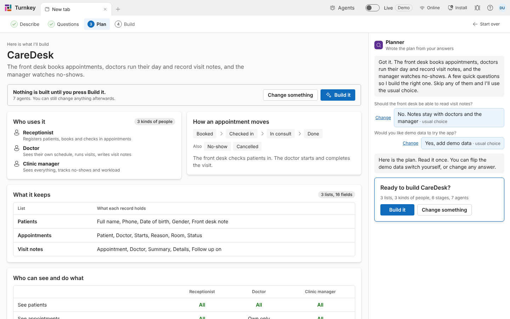</td>
  </tr>
  <tr>
    <td><em>The Planner asks before anything is built. Each card has a usual choice and can be skipped.</em></td>
    <td><em>The plan in plain words. Nothing is built until the owner presses Build it.</em></td>
  </tr>
  <tr>
    <td>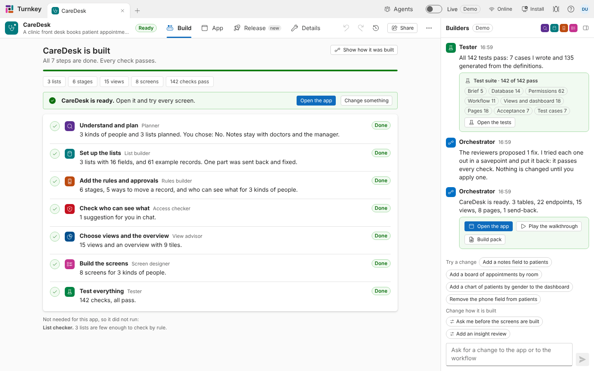</td>
    <td>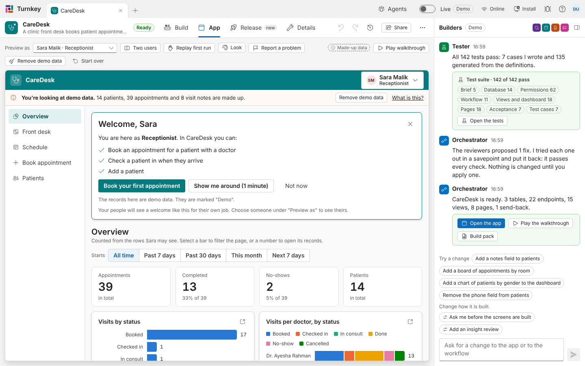</td>
  </tr>
  <tr>
    <td><em>The build as a list of steps: who did each one and what it made. "Show how it was built" opens the workflow canvas.</em></td>
    <td><em>The app's first use: a welcome for each kind of person, a short tour, and demo data that is marked and removable.</em></td>
  </tr>
  <tr>
    <td>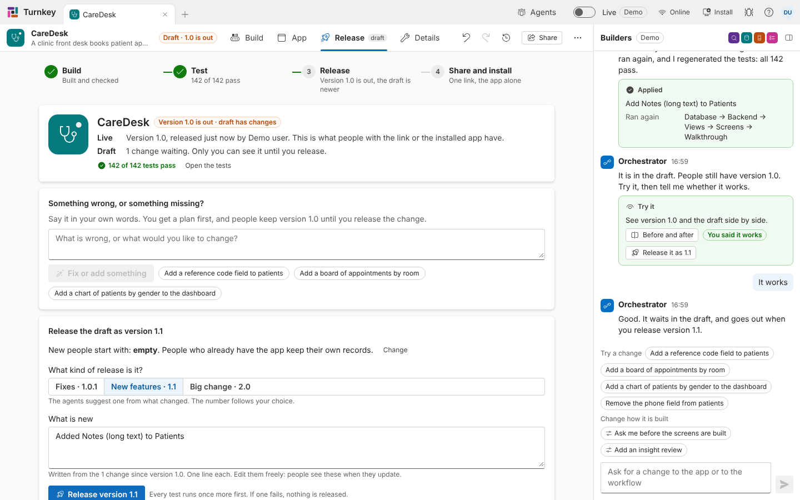</td>
    <td>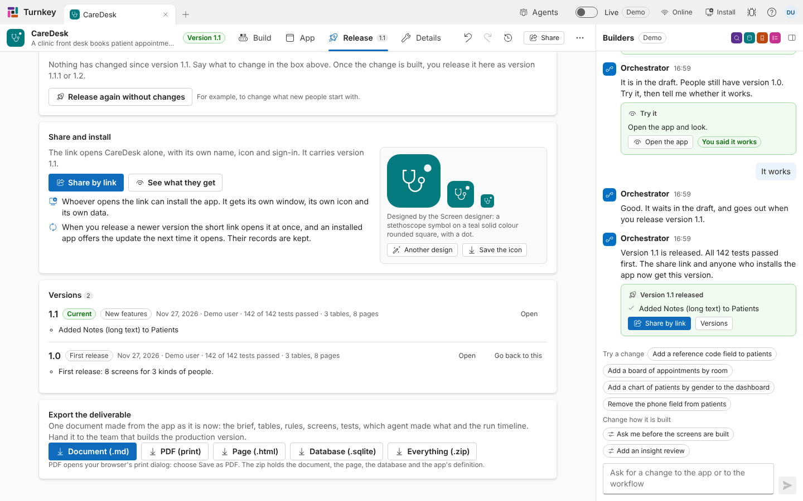</td>
  </tr>
  <tr>
    <td><em>A change after 1.0 goes to a draft. The owner tries it, says it works, and picks the kind of release.</em></td>
    <td><em>Every release keeps its tests and notes, and the owner can go back to an earlier one.</em></td>
  </tr>
  <tr>
    <td>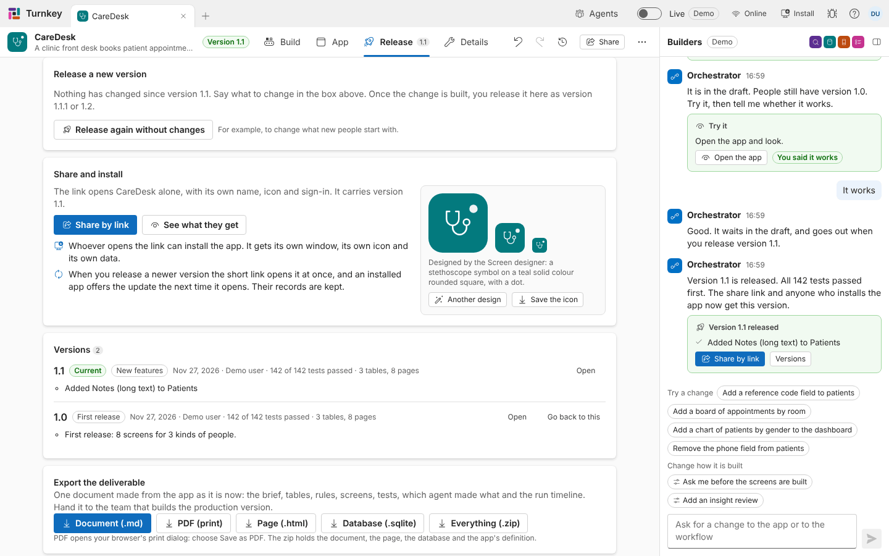</td>
    <td>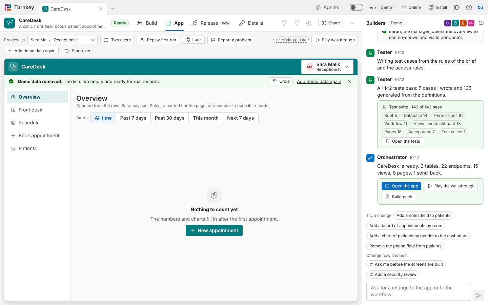</td>
  </tr>
  <tr>
    <td><em>The owner can always release again. With nothing changed, the page says how to get to the next version.</em></td>
    <td><em>Demo data goes in one step, and the app is ready for real records.</em></td>
  </tr>
</table>

To see the agents' teamwork in detail, press **Try a sample** on the first screen instead: it asks one question
about the **Sales bidding desk** with the usual answer marked, shows the plan, and builds it when you press **Build it**. There the Tester catches a planted slip and an agent team inside the app works on a tender.
The longer walk-through is below, and the three-minute demo script is in
[`docs/hackathon/demo-video.md`](docs/hackathon/demo-video.md).

## How the agents work together

The **Planner** turns the sentence into a plan: up to five question cards with a usual choice each, then the plan
from the answers. In Live these are two model calls; in Demo the plan is read off the saved build. Code, not a model,
then picks the team from the plan: **List builder** (lists, fields and demo data), **Rules builder** (stages, actions
and who can see and do what), **View advisor** (views and the overview), **Screen designer** (screens and the
welcome for each kind of person) and **Tester** (test cases), with an **Access checker** added when people keep
records to themselves and a **List checker** when there are many lists. Steps a plan does not need do not run, and
the Build tab says why. The owner's workflow on the canvas is compiled into a LangGraph graph, and that graph runs
the build. Code decides whether each answer is good enough:

- **Hand-off.** Each agent gets the approved plan and the checked output of the agents before it, and is held to the
  plan (a List builder that leaves out a planned list is sent back).
- **Check and send back.** After every step, code applies the answer (creates the tables, calls every endpoint as
  every role, draws every view and screen) and checks it. A failure goes back to the same agent with the failures in
  its next prompt, three attempts at most, then a safe built-in default or a clear stop.
- **Repair from tests.** The Tester writes test cases from the plan; code plays them; a failing test goes back to the
  Rules builder, whose fix must pass the same checks as any change. An app is ready only when its tests pass.
- **The owner decides.** Nothing is built before the owner approves the plan. The owner can put approval gates after
  any step, add review agents or their own agents to the line, and a change that deletes data waits for a yes. After
  a release, a change gets a plan and goes to a draft; people keep the released version until the next release.
  Editing the workflow re-runs only the steps it touches, and so does editing the app itself on the canvas: adding,
  renaming or removing a field on the Data page, or changing the navigation, row density or colour from the **Look**
  menu on the App page, goes through the same plan card as a change typed in chat.
- **Visible.** Every step is an AG-UI event: the steps list, the canvas, the timeline, the log, the meeting view, the
  Agents panel and debug mode all read the same stream, and each table, field and screen shows which agent made or
  last changed it.

In **Live**, each agent's turn runs on the server as a small LangGraph graph (draft, check the JSON against the
role's schema, repair, at most three model calls) behind the CopilotKit runtime, streamed to the browser over AG-UI.
On the workflow canvas each station keeps a short job name (Research, Database, Backend, Views, Screens,
Walkthrough, Tests) next to the name of the agent that does it.

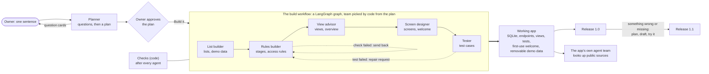

The full sequence of a build, one agent step on the server, a team run, a change from chat and the release pipeline
are in [`docs/architecture/overview.md`](docs/architecture/overview.md).

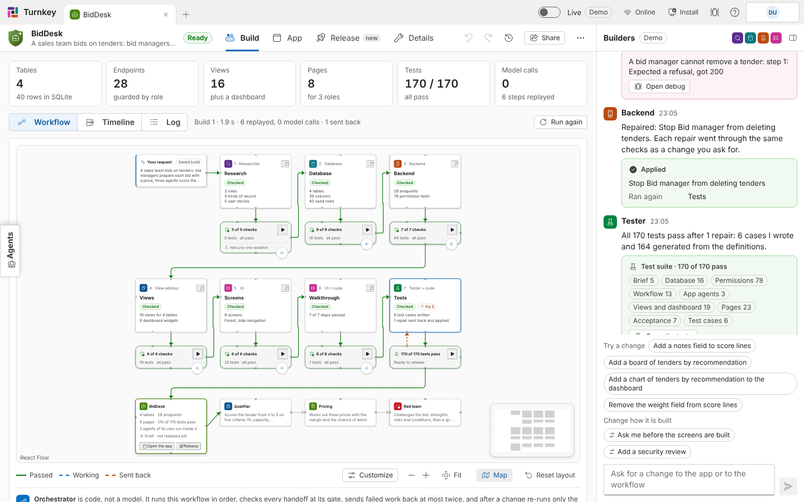

_Behind "Show how it was built": each agent is a node and each check is a gate under it. The chat on the right holds the agents' cards and suggested changes._


_The Agents panel explains the team in the app itself; its Activity tab lists every step, tool call and hand-off as it happens._


_The Tester's first run fails one case (a bid manager could delete a tender); the Rules builder repairs it and run 2 passes._

<table>
  <tr>
    <td width="50%">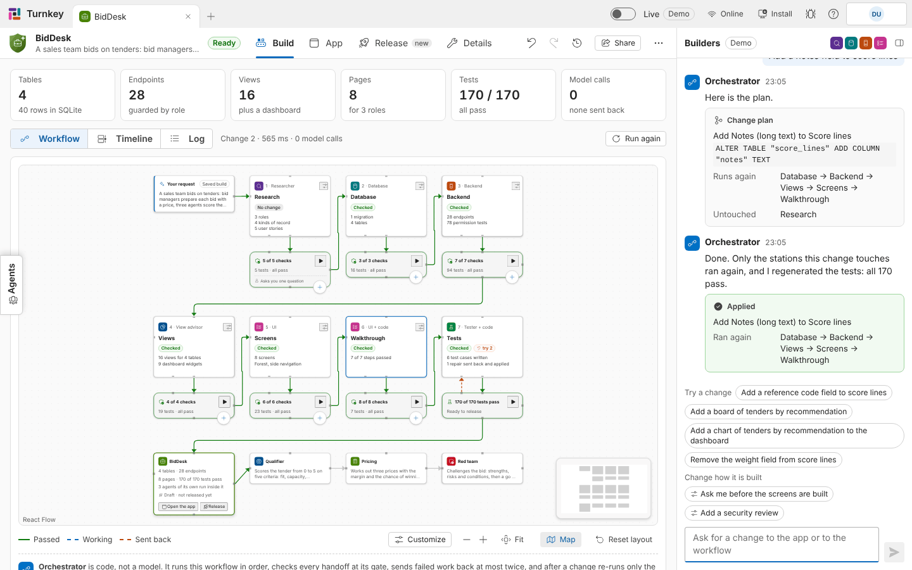</td>
    <td width="50%">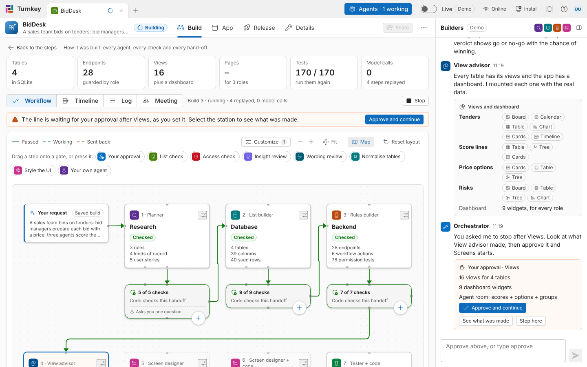</td>
  </tr>
  <tr>
    <td><em>A change from chat. The Orchestrator shows its plan as a card; only the stations the change touches run again.</em></td>
    <td><em>An approval the owner placed after Views. The build waits on the canvas and in chat until the owner answers.</em></td>
  </tr>
  <tr>
    <td>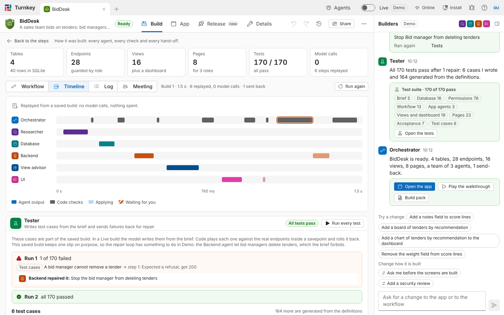</td>
    <td></td>
  </tr>
  <tr>
    <td><em>The run timeline, one lane per agent. The line on top gives the model calls, tokens and cost; a saved build spends nothing.</em></td>
    <td><em>Version history. Every change is a version that names the agents or the person who made it.</em></td>
  </tr>
</table>

## What it builds

Nine saved builds come with the app, each a separate working app. Six have their own agent team inside: the three
suggested quests, Fact-check desk (Extractor, Researchers, Verifier), Prior-art scout (Search, Analyst, Critic) and
Debate partner (For, Against, Moderator), plus Sales bidding desk (Qualifier, Pricing, Red team) and Grant review desk
(Assessor, Budget reviewer, Due diligence). The others are plain business apps: clinic appointments, IT helpdesk,
leave requests and purchase requests. In Live, a team runs on the server as a LangGraph graph: agents in order,
lookups in Wikipedia, World Bank, OpenAlex, arXiv or PatentsView where the agent has the tool, a check after each
agent that can send the work back once, and a pause where a person adds a point. Where a team could be used:
[`docs/hackathon/use-cases.md`](docs/hackathon/use-cases.md).


_The Bid room of the built BidDesk app, with the three agents' verdict for one tender. All data is made up._

## The five-minute walk-through

**Part 1: a guided build, from a sentence to version 1.1 (about two minutes, no model calls with Live off).**

1. Open the live app and press **Describe your own**. It signs you in with a demo account and opens an empty
   workspace. If **Live** is on in the title bar, switch it off to follow these steps exactly; leave it on to have the
   Planner model interview you about your own sentence instead.
2. Type `A clinic books appointments for patients with its doctors` and press Enter. The steps bar shows Describe,
   Questions, Plan, Build. Answer "Should the front desk be able to read visit notes?" (or **Skip this one**), then
   the demo data question. Press **Change** beside an answer to see the plan follow it.
3. Read the plan: three kinds of people, three lists with their fields, six stages, a table of who can see and do
   what, and the agents that will build it. Press **Build it**.
4. The **Build** tab lists seven steps with the agent of each. The List builder's first attempt is sent back and fixed,
   the Access checker leaves one suggestion in chat, and all 142 checks pass. **Show how it was built** opens the same
   run as a workflow canvas, timeline, log and meeting; **Change something** opens the change box on Release, which
   works before version 1.0 too.
5. Open **App**, sign in as Sara Malik (receptionist). Her welcome lists what she can do; **Show me around** is a
   four-stop tour. Pick someone else under **Preview as** to see the welcome for their job. **Remove demo data**
   empties the lists in one step, and the tests still pass; **Undo** brings the records back.
6. Open **Release** and release version 1.0 (every test runs first). Under "Something wrong, or something missing?"
   press **Add a notes field to patients**. The Orchestrator says it is a new feature, shows a plan, and builds it
   only after **Go ahead**. The change waits in a draft: compare **Before and after**, press **It works**, then
   **Release it as 1.1**. The release offers Fixes 1.0.1, New features 1.1 or Big change 2.0, and the Versions list
   keeps both releases with **Go back to this**. Above them, "Release a new version" explains what comes next, and
   **Release again without changes** puts out 1.1.1 once you give a reason.

**Part 2: the agents' teamwork in detail (about three minutes).**

1. Open the live app in a private window and press **Try a sample**. It keeps **Demo** on and opens the
   **Sales bidding desk**'s interview: one question (demo data, usual answer marked). Press **Use the usual choices and
   show me the plan**, read the plan, then **Build it**. The build starts with a four-step tour. Because the plan has
   money and several kinds of people, the build stops once on **Build** for you to check the rules: press **Looks
   right, continue**.
2. On **Build**, press **Show how it was built**. Each agent is a node with a check gate under it. The Tester's first
   run catches the Rules builder's slip (a bid manager could delete a tender), the Rules builder repairs it, and run 2
   passes all 170 tests. Switch between **Workflow**, **Timeline**, **Log** and **Meeting** (a tile per agent, the
   one at work rings, an agent waiting for you raises a hand), and open **Agents** on the left edge for every step,
   tool call and hand-off.
3. Open **App** and sign in as Sana Malik (bid manager), then as Omar Farooq (sales director) from **Preview as**:
   each role sees only what its rules allow. In the **Bid room**, pick **Port fleet tracking** and press **Run the
   agents**. The Qualifier scores it, Pricing prices it, and the run stops for you to add a condition before the Red
   team gives its verdict. In Live, the case header and each agent's line show what its model calls cost.
4. In the chat sidebar, press **Add a notes field to score lines** (or type a change). The Orchestrator shows a plan,
   only the steps the change touches run again, and the tests are regenerated.
5. Or change the app on the canvas. Under **Details**, **Data**, pick **tenders**, open **Columns** and add a field:
   the edit appears in chat as yours, and the plan keeps Research and runs again from Database. On the **App** tab,
   the **Look** menu moves the navigation to an icon rail, and only Screens onwards runs again.
6. Turn on debug mode (bug icon in the title bar) to see AG-UI events, tool calls, SQL and model usage.

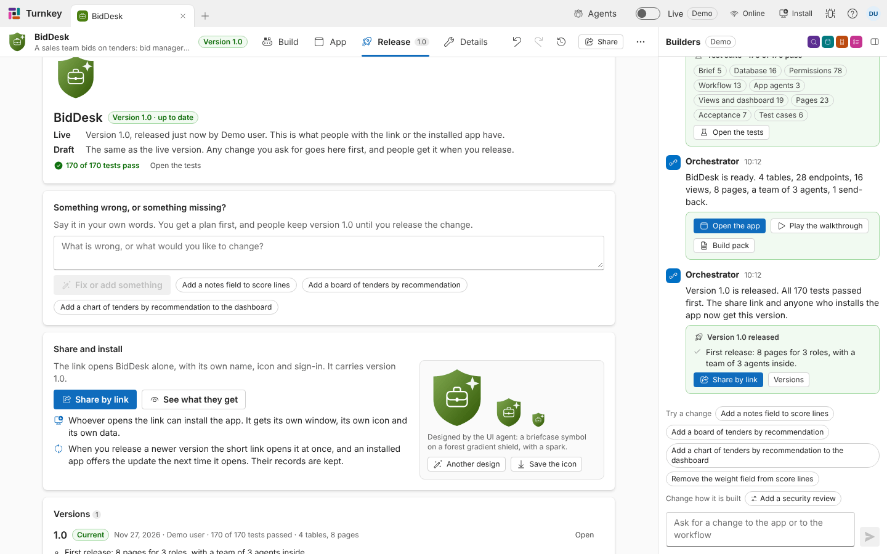

_The Release tab. One deliverable document is made from the app as it is now, in each format._

To see Live agents build from your own words, leave **Live** on and type a sentence on a new tab. The Planner asks
its questions and writes the plan with real model calls, and the build follows the plan you approve. Each Live
session is capped at 40 model calls.

## What is in it

- **Guided build:** a sentence opens an interview (up to five question cards from the Planner, each with a usual
  choice), then a plan in plain words that the owner approves with Build it; code picks the agents from the plan and
  skips the ones it does not need. Each built app opens with a welcome and a short tour for each kind of person, demo
  data that is marked and can be removed or added back, and empty screens that say what to do first. After a release,
  "Something wrong, or something missing?" gives a plan, a draft only the owner sees, a try-it step and the next
  version (1.0.1, 1.1 or 2.0). The change box is there before the first release too, the finished build has a
  **Change something** button, and the owner can always release again.
- **Workspace:** a Build tab that opens on a plain list of steps (one row for each job and the agent that does it),
  with the workflow canvas, timeline, log and meeting view behind "Show how it was built"; edits to fields and the look on the canvas that
  re-run only the stations they touch; Agents panel and a "How it works" page; chat sidebar with the
  agents' cards; 14 view types and dashboards in the built apps; releases with a test gate; share by short link;
  install a built app under its own name and icon; works offline for saved builds; phone and tablet layouts; Fluent 2
  UI (`@fluentui/react-components` v9); first-run guide.
- **Data:** each app's SQLite database (sql.js) and the workspace live in the browser's IndexedDB, with backup and
  restore, and export and import of an app's `.sqlite` file. Nothing about an app is kept on the server, except a
  shared app saved under a short link.
- **Server:** `/api/copilotkit` (CopilotKit runtime, AG-UI agents `step` and `team`), `/api/agent/team` (team runs as
  server-sent AG-UI events), `/api/llm`, `/api/connectors/<name>`, `/api/share`, `/api/health`. A model gateway for a
  Claude API key, LiteLLM, any OpenAI-compatible service, the Claude Code CLI (local only) and a stand-in for tests,
  with effort per tier, prompt caching and a cost line per call, shown per agent in team runs. Microsoft Learn is
  reached through its public MCP server (no key), and the Connections page tests it live.
- **Guard rails:** only Turnkey's own agent prompts are relayed; per-visitor and global rate limits; a daily call cap
  and a daily dollar cap; 40 model calls per Live session; `LIVE_MODE=off` switch; cross-site calls refused. See
  [Budget](#budget).
- **Checks:** unit tests (vitest) and 12 browser flows in CI (Playwright), including accessibility (axe), phone and
  tablet sizes and offline; a smoke test of the live site after each release.

The app's About dialog ("What is real in this prototype") says what Demo replays and what Live does for real.

## Budget

The model budget is small and does not refill, and it also covers judging. Demo needs no model at all. In Live,
`src/server/guard/limits.ts` caps calls at 20 per visitor and 50 for everyone per minute, 600 a day and 5 dollars a
day (priced from the tokens each call used), and the workspace stops a session after 40 model calls. Quick steps use
the cheaper model tier. `/api/health` shows the calls and the spend so far.

## Submission summary

> Turnkey turns one sentence into a working business app. A Planner agent asks a few questions and shows a plain-words plan; once the owner approves, code picks the team (lists, rules, views, screens, tests, access) and a LangGraph workflow streams every step over AG-UI. Code checks each handoff and sends failed work back; failing tests go back for repair. Each app opens with a welcome per role and removable demo data. Any later change gets a plan and a draft, then ships as 1.1. Built apps can carry agent teams that search public sources. Demo mode needs no model.

(Counted: 568 characters.) Evidence for each rule and criterion: [`docs/hackathon/criteria.md`](docs/hackathon/criteria.md).

## More documents

- [`docs/architecture/overview.md`](docs/architecture/overview.md): diagrams of how it is built
- [`docs/adr/`](docs/adr/README.md): the ten design decisions and why
- [`docs/architecture/ag-ui.md`](docs/architecture/ag-ui.md): how agents stream their steps over AG-UI
- [`docs/hackathon/submission.md`](docs/hackathon/submission.md): what goes into the submission form
- [`docs/hackathon/demo-video.md`](docs/hackathon/demo-video.md): the demo video script and shot list
- [`docs/hackathon/criteria.md`](docs/hackathon/criteria.md) and [`use-cases.md`](docs/hackathon/use-cases.md)
- [`docs/PLAN.md`](docs/PLAN.md): the build plan and who owns which folders
- [`docs/RUNBOOK.md`](docs/RUNBOOK.md): how agents work on this repository in parallel

## The two pages

- **Workspace** at `/`: the full product. It runs on saved builds with no model configured, and on live agents
  once a model key is set on the server. A shared app saved under a short link opens at `/<name>`.
- **Spike** at `/spike`: one streamed tool call from the model that updates shared canvas state, through CopilotKit
  (AG-UI) and LiteLLM. Kept as the proof that the stack works end to end.

## Run it

```bash
npm ci
npm run dev                      # http://localhost:3000, saved builds only
LLM_PROVIDER=mock npm run dev    # a stand-in model: no key, no network, no cost
LLM_PROVIDER=claude-code npm run dev  # your local Claude Code login (development only)
```

To use a real model, copy `.env.example` to `.env.local` and fill in one backend. On Vercel, set the same names under
Settings → Environment Variables, then cut a release (merges do not deploy; see
[`docs/process/deploy.md`](docs/process/deploy.md)).

| Backend                        | Names                                                                                              |
| ------------------------------ | -------------------------------------------------------------------------------------------------- |
| Claude API key (the live site) | `ANTHROPIC_API_KEY`; optional `ANTHROPIC_MODEL`, `ANTHROPIC_MODEL_FAST`                            |
| A LiteLLM gateway              | `LITELLM_BASE_URL` (with `/v1`), `LITELLM_API_KEY`, `LITELLM_MODEL`; optional `LITELLM_MODEL_FAST` |
| Any OpenAI-compatible service  | `OPENAI_API_KEY`, `OPENAI_MODEL`; optional `OPENAI_MODEL_FAST`, `OPENAI_BASE_URL`                  |

`LLM_PROVIDER` forces one; otherwise the first that is set is used, in the order above. Details:
[`src/server/llm/README.md`](src/server/llm/README.md). Keys are read only by server code. Never commit one, never put
one in a `NEXT_PUBLIC_` variable.

Check a deployment:

| Address                   | Tells you                                                                                              |
| ------------------------- | ------------------------------------------------------------------------------------------------------ |
| `/api/health`             | the app is up, which backend answers, which commit is deployed, calls and spend so far. Costs nothing. |
| `/api/health?probe=1`     | one tiny model call: is the key accepted and the model name right                                      |
| `/api/health?probe=tools` | one tool call: can the configured model call tools, and which models the key can see                   |

## Check your work

```bash
npm run check                 # secrets scan, lint, typecheck, unit tests
npm run test:e2e -- demo      # one browser flow; CI runs all twelve
```

The README's pictures come from `scripts/readme-media.mjs`: start a production build (`npm run build`, then
`PORT=3333 npx next start`) and run `TK_URL=http://localhost:3333 node scripts/readme-media.mjs`. It needs ffmpeg, uses
Demo data only, and writes the PNGs (the guided clinic build first, then the Sales bidding desk) and `demo.gif` (a sentence typed on Home, through the question, the plan and the build, to the app's welcome) to `docs/images/`.

## The spike

One streamed tool call from the model updates shared canvas state:

1. You type in the chat sidebar on `/spike`.
2. `src/app/api/copilotkit/[[...slug]]/route.ts` runs the Architect agent (CopilotKit `BuiltInAgent`, in process)
   against LiteLLM's OpenAI-compatible endpoint (`src/lib/model.ts`).
3. The model calls the frontend tool `add_canvas_node` (fixed catalog of node kinds, `src/lib/canvas.ts`).
   Its arguments stream over AG-UI to the browser.
4. The browser adds the node to the canvas, mirrors it into AG-UI shared state, and saves it to localStorage.

## Layout

```
src/app/(workspace)  the workspace page, and /<name> for short links
src/app/(spike)      the spike page
src/app/a            per-app web manifest and icon, for installing a built app
src/app/api          routes: copilotkit (AG-UI), agent/step, agent/team, llm, connectors, share, health
src/workspace        the workspace UI: React modules with JSX
src/platform         browser side: workflow graph (orchestrator), AG-UI client, model client, storage, PWA, sql.js
src/server           server only: model gateway, agent graphs, agent schemas, AG-UI registry, connectors, guard rails, short links
src/shared           types and schemas used by both sides, the agent contract, SQL checks
tests/unit           vitest
tests/e2e            the browser flows
docs                 plan, architecture, decisions, hackathon evidence
.claude              agents, skills, rules and hooks for Claude Code
```
