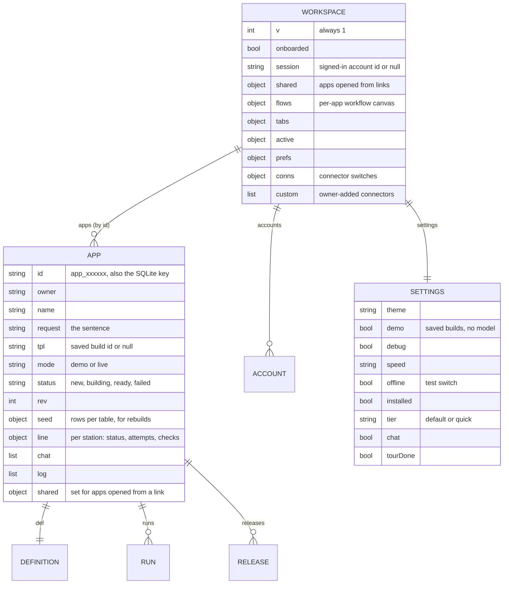
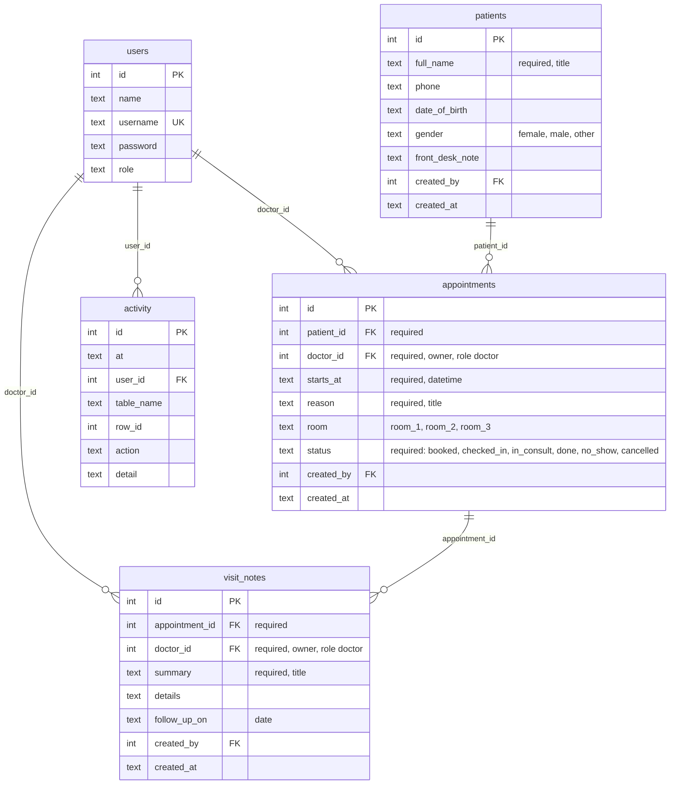
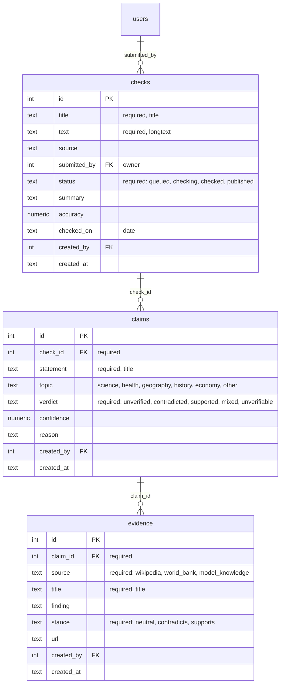

# Data model and storage

Everything the visitor makes stays in their browser. Vercel's free plan keeps nothing between requests, and the
owner asked for apps and records that are still there after a reload, so there is no server database. Two things
are stored: the **workspace state** (one JSON text) and **one SQLite file per app**. This page describes both, how
they are saved today, the storage adapter that replaces the 5 MB limit, how to switch the workspace to it, backup
and export, and the checks on generated table definitions.

Code: `src/platform/storage/` (adapter, files), `src/shared/sql/` (definitions, validator, SQL generator).
Tests: `tests/unit/storage/`, `tests/unit/sql/`.

## 1. What is stored, and where

| Key (after the prefix `formwork:v1:`) | Value                                     | Written by             |
| ------------------------------------- | ----------------------------------------- | ---------------------- |
| `state`                               | `JSON.stringify(S)`, the workspace state  | `saveNow` in `core.js` |
| `db:<appId>`                          | the app's SQLite file, base64 (`b64.enc`) | `dbFlush` in `db.js`   |

Nothing else is stored. Both writes are debounced (300 ms for state, 350 ms for a database) and every write goes
through the `LS` object in `core.js`:

```
LS.get(k) / LS.set(k, v) / LS.del(k) / LS.keys() / LS.size(k) / LS.probe()
LS.ok   false when browser storage is blocked, then values live in an in-memory object `MEM`
LS.full true after a `set` that the browser refused (quota)
LS.why  the browser's message
```

`LS.set` returns `false` when the browser refuses. `dbFlush` then shows one toast ("Browser storage is full…").
`saveNow` ignores a failure except for not updating `U.savedAt`.

The limit is about 5 MB of text for the whole origin, and base64 adds a third to every database. A handful of apps
fill it. That is the reason for the adapter in section 4.

## 2. The workspace state (`S`)

Created by `freshState()` in `core.js`, saved whole as `state`. Version field `v: 1`; `loadState` rejects anything else.



The SQLite file is not inside `S`. `S.apps[id]` and `db:<id>` are tied only by the id. Deleting an app must delete
both (`deleteApp` calls `dbDrop`).

## 3. The app definition (`app.def`)

`blankDef()` in `line.js`. Each station of the build line writes one part, after its output passed that station's
checks (`APPLY.research`, `APPLY.database`, … in `line.js`). The Database station writes `tables` and `users`; this
is what the validator in `src/shared/sql` covers.

```
def = {
  brief:  { name, summary, roles[{id,name,can}], entities[{name,what}],
            process{entity,states[],note}, stories[], rules[], question, decision, sources }
  tables: [ table ]          // max 8
  users:  [ { name, role, username, password } ]    // seeded people, at most 12
  process, access, team      // Backend station
  views, dash, board         // Views station
  screens, theme, tour, actions   // Screens station
  migrations: []
}

table  = { name, label, one, title, owner, by, run,
           columns: [ column ]   // max 12, the runtime adds id, created_by, created_at
         }
column = { name, label, type, required, options?, labels?, ref?, role?, by, run }
```

Column types and what each becomes in SQLite (`TYPES` in `engine.js`, `SQLT` in `db.js`):

| Type       | SQLite    | Extra                                                         |
| ---------- | --------- | ------------------------------------------------------------- |
| `text`     | `TEXT`    |                                                               |
| `longtext` | `TEXT`    |                                                               |
| `number`   | `NUMERIC` |                                                               |
| `money`    | `REAL`    |                                                               |
| `date`     | `TEXT`    | `YYYY-MM-DD`                                                  |
| `datetime` | `TEXT`    | `YYYY-MM-DDTHH:MM`                                            |
| `bool`     | `INTEGER` | `DEFAULT 0`                                                   |
| `select`   | `TEXT`    | `CHECK (col IN (options…))`, `options` needed, snake_case     |
| `ref`      | `INTEGER` | `REFERENCES "<ref>"("id")`, `ref` is another table of the app |
| `user`     | `INTEGER` | `REFERENCES "users"("id")`, optional `role` limits the person |

`required` adds `NOT NULL`. Names are snake_case: `snake()` lower-cases, turns anything but letters and digits into
single underscores, prefixes `n` before a leading digit, cuts to 32 characters.

The `app.seed.rows[table]` list holds the seed rows. They use day offsets for dates and row positions for links,
and are inserted by `insertSeed` in parent-first order (`topoOrder`).

## 4. The SQLite schema as generated

`buildDatabase` in `engine.js` runs `SYS_SQL` and then `createTableSQL` for each table, in the order given. One
database per app, `PRAGMA foreign_keys = ON`. `schemaSql(tables)` in `src/shared/sql/ddl.ts` produces the same
statements and is tested against every saved build.

Always present:

```sql
CREATE TABLE "users" (
  "id" INTEGER PRIMARY KEY AUTOINCREMENT,
  "name" TEXT NOT NULL, "username" TEXT NOT NULL UNIQUE,
  "password" TEXT NOT NULL, "role" TEXT NOT NULL);
CREATE TABLE "activity" (
  "id" INTEGER PRIMARY KEY AUTOINCREMENT, "at" TEXT NOT NULL,
  "user_id" INTEGER REFERENCES "users"("id"),
  "table_name" TEXT NOT NULL, "row_id" INTEGER, "action" TEXT NOT NULL, "detail" TEXT);
```

For every table the app defines, the runtime puts `id` first and `created_by` (a user) and `created_at` last.
Passwords in `users` are demo passwords for made-up people.

### Clinic app (saved build `clinic`)

Roles: receptionist, doctor, manager. Process on `appointments`.



`created_by` on every table points at `users` too; those lines are left out of the diagram to keep it readable.

### Fact-check app (saved build `factcheck`)

Roles: editor, senior_editor, reader. Process on `checks`. The app's own agent team (Extractor, Researchers,
Verifier) writes to `claims` and `evidence` through the same endpoints as people.



## 5. Storage adapter (`src/platform/storage`)

`openStorage(options)` returns a `TurnkeyStorage` with the same behaviour as `LS`: `get`, `set`, `del`, `keys`,
`size`, `probe`, and the fields `ok`, `why`, `full`. Keys and values are exactly what `LS` stores, so nothing about
the stored formats changes: `formwork:v1:state` and `formwork:v1:db:<appId>`, text values, base64 databases.

**Design.** The workspace calls storage synchronously and IndexedDB is asynchronous. So:

1. `await openStorage()` reads every key from IndexedDB into an in-memory mirror. The workspace must start after it resolves.
2. `get`, `keys`, `size` read the mirror. `set` and `del` change the mirror at once and queue the key.
3. About 150 ms later the queue is saved in one IndexedDB transaction. A newer write to the same key stays queued.

**Where it keeps data (`storage.mode`).**

| Mode           | When                                  | `ok`  | Notes                                                                  |
| -------------- | ------------------------------------- | ----- | ---------------------------------------------------------------------- |
| `indexeddb`    | normal                                | true  | hundreds of MB, depending on the browser                               |
| `localstorage` | IndexedDB blocked or failing          | true  | same limit as today; `set` returns false when the browser refuses      |
| `memory`       | both blocked (private frames, policy) | false | works until the tab closes; `ok` is false so the existing banner shows |

**Migration.** On the first open of an origin, `formwork:v1:*` keys in localStorage are copied into IndexedDB, read
back and compared, the flag `migrated-from-localstorage` is stored, and only then are the localStorage copies
removed (`clearLegacy: false` keeps them). A key already in IndexedDB wins. If anything fails, localStorage is
left alone, the data is served from memory, the problem is reported, and the next open tries again. It runs once.

**Quota and other failures are reported, never swallowed.** A failed save keeps the value in the mirror and in the
unsaved list, sets `full` for a quota error, calls every `onProblem` listener with `{ kind: 'quota' | 'write' |
'migrate' | 'open', message, unsaved }`, and retries on the next write or `flush()`. `status()` gives
`{ mode, durable, full, why, unsaved, keys, bytes, migrated }` for a "storage" panel. `estimate()` and `persist()`
wrap `navigator.storage`. An optional `maxBytes` makes `set` return `false` before the browser is full, which is
what makes `dbFlush`'s existing "storage is full" toast fire.

**The one gap.** IndexedDB cannot be awaited while a page closes. `flushOnHide(storage)` saves on `visibilitychange`
(to hidden) and `pagehide`, which covers tab switches, mobile and most closes. A very quick close within the save
delay can lose the last edit; the cost is at most one debounce of typing, the same order as today's 300 ms debounce.

### How integration puts it under the workspace without changing stored formats

`src/legacy` is not edited. The workspace reads storage only through the global `localStorage` (inside the
`LS` object), at the moment `LS` runs. Two ways, in order of preference.

**A. Provide the storage object before boot (no change to `src/legacy`).** In `src/platform/boot.ts`, before
`bootLegacy()` runs:

```ts
import { openStorage, flushOnHide } from '@/platform/storage';

const storage = await openStorage({ onProblem: (p) => console.warn('[storage]', p) });
Object.defineProperty(window, 'localStorage', { value: storage.asStorage(), configurable: true });
flushOnHide(storage);
(window as any).__turnkeyStorage = storage; // for the data page and tests
// then: bootLegacy()
```

`asStorage()` implements `getItem`, `setItem`, `removeItem`, `key`, `length` and `clear`, which is all `LS` calls
(`probe`, `get`, `set`, `del`, `keys`). A `setItem` that cannot be kept throws a `QuotaExceededError`, so
`LS.set` returns `false` and sets `LS.full` as it does today. Because `LS.probe()` succeeds, `LS.ok` stays true;
in memory mode the adapter still accepts writes, and `storage.ok` is the thing to show a warning from.
I could not test this in a real browser (the tests use jsdom and run the workspace's own `LS` code against
`asStorage()`, which passes). Integration must check in Chrome that `defineProperty` on `window.localStorage` is
accepted. Boot should wrap the call in `try` and, on failure, continue with the real localStorage (today's behaviour)
or use B.

Note what this changes for other code: anything else on the page that uses `localStorage` (the compat layer, the
PWA code) sees the adapter too. The adapter passes keys outside `formwork:v1:` through to IndexedDB unchanged, so
that is harmless, but those keys are not migrated.

**B. Replace the methods of `LS` after the bundle defines it.** `Object.assign(LS, storage.lsCompat())` is not
possible from outside, because `LS` is a `const` inside the bundle's scope; it needs a one-line seam in
`src/legacy/core.js`, for example `const LS = window.__turnkeyLS || { … }`, which integration owns. `lsCompat()` returns an
object with the exact `LS` surface for this.

**Order of events.** `openStorage()` (reads IndexedDB, migrates) → define `localStorage` → `bootLegacy()` →
`loadState()` reads `state` from the mirror. The workspace's own `LS.probe()` call (in `shell-c.js`) runs against the
adapter and returns true.

**Settings page numbers.** `shell-b.js` and `shell-c.js` show `LS.size(k)` per key and total bytes: `asStorage` keeps
`LS.keys()` and `LS.size()` correct because they derive from `getItem`/`key`/`length`. The sentence "Everything is kept
in this browser's localStorage" becomes untrue and should say IndexedDB; that text is in `shell-b.js`.

## 6. Export, import and backup (`src/platform/storage/files.ts`)

All functions take anything with `get`, `set`, `del`, `keys` (a `TurnkeyStorage`, or the `LS` object).

| Function                                                  | What it does                                                                                                                  |
| --------------------------------------------------------- | ----------------------------------------------------------------------------------------------------------------------------- |
| `exportAppSqlite(store, appId)`                           | the app's database as bytes for a `.sqlite` download, or `null`. `sqliteFileName(name)` names it.                             |
| `inspectSqlite(SQL, bytes)`                               | opens a file with sql.js, runs `PRAGMA integrity_check`, lists tables and row count                                           |
| `importAppSqlite(store, appId, bytes, { SQL, mustHave })` | checks the file (header, integrity, required tables) and stores it as `db:<appId>`; restores the old value if storage is full |
| `createBackup(store)` / `backupToText(store)`             | one JSON object: `{ f: 'turnkey-backup', v: 1, at, items: { state, 'db:<id>': base64 } }`                                     |
| `parseBackup(text)`                                       | validates a backup file: format, version, only `state` and `db:<id>` keys, state is v1 JSON                                   |
| `restoreBackup(store, backup, 'replace' \| 'merge')`      | writes it back; on a full store every key already changed is put back, so a failed restore changes nothing                    |

Errors are `DataFileError` with a `code` (`not_sqlite`, `damaged`, `not_a_backup`, `wrong_version`, `storage_full`,
`bad_id`) and a plain message. After `importAppSqlite` or `restoreBackup` the workspace must drop its open copies
(`dbDrop` for the app's open database) or reload, since it keeps `S` and the databases in memory. A reload is the
simple, safe choice for a restore. Import of one `.sqlite` needs the app to exist in `S` (the caller checks); the
file must contain the app's tables, which `mustHave` enforces.

## 7. Checking generated table definitions (`src/shared/sql`)

Used before a definition is stored, on the server (to validate an agent's output and produce a repair hint) and in
the browser. No dependencies, no Node or DOM APIs.

- `normalizeTables(input, { roleIds })` mirrors `normSchema` in `engine.js`: `snake()` names, type words mapped
  (`TYPE_ALIAS`), `ref` to `users` becomes `user`, system columns and duplicate columns dropped, 12 columns kept,
  `title` and `owner` repaired. It never throws.
- `validateTables(tables, { roleIds, process })` checks a definition and does not change it. Errors (must fix):
  names that are not `^[a-z][a-z0-9_]{0,31}$`, reserved tables (`users`, `activity`, `sqlite_*`) and columns
  (`id`, `created_by`, `created_at`), unknown column types, `select` without snake_case options, `ref` without a
  target or to a table that does not exist (or to `users`), missing or wrong `title` and `owner`, more than 8
  tables or 12 columns in a table, duplicates, a `role` the brief does not have, and a process entity whose `status`
  is not a choice with exactly the process states. Warnings: links in a circle (seed rows cannot be added in order),
  stray `options` or `ref`, more seed rows than the 40 kept.
- `issueLines(result)` turns errors into lines for a repair prompt, for example `appointments.room_id: "room_id" points to "rooms", which is not one of the tables (…)`.
- `schemaSql(tables)` returns the `CREATE TABLE` statements the workspace runs; `createTableSql`, `columnSql`,
  `quoteIdent`, `quoteLiteral`, `tableOrder` match `createTableSQL`, `colSQL`, `qi`, `ql`, `topoOrder` in `db.js`/`engine.js`.

Agreement with the workspace is tested against the real definitions: `tests/unit/sql/legacy-records.ts` runs the saved
builds (`REC` in `builds.js` and `quests.js`, all seven apps) in a sandbox, and the tests check that they normalise to
themselves, validate with their own roles and process, and that `schemaSql` creates the tables in real SQLite.

Differences from `checkSchemaShape`: the workspace check "A seeded user for every role" is about `users`, not tables,
and is not part of this validator. The prompt in `line.js` asks for "at most 8 columns per table", but `LIMITS.cols` is
12 and `normSchema` keeps 12; the validator uses 12, as the design says.
