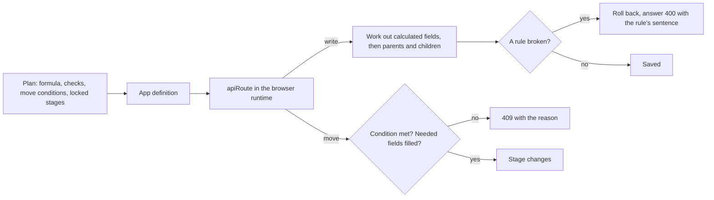

# Calculated fields, rules and conditions

A built app can do more than keep records. It can work numbers out, refuse a save that breaks a rule, hold a move back
until a condition is met, and lock a record once it reaches a stage. All of this is data in the app's definition. No
generated code runs.

## The formula language (`src/shared/logic`)

A formula is a short text such as `quantity * unit_price` or `sum(order_lines.line_total)`. `expr.ts` parses it into a
tree and evaluates the tree. The text is never run as code, is at most 400 characters long and nests at most 24 deep.

| Form                                                                  | Meaning                                                                                                                                    |
| --------------------------------------------------------------------- | ------------------------------------------------------------------------------------------------------------------------------------------ |
| `a + b`, `a * b`, `a <= b`, `a and b`, `not a`                        | arithmetic, comparison and logic on the record's own fields                                                                                |
| `department.remaining`                                                | a field of the record a link points to                                                                                                     |
| `sum(order_lines.line_total)`, `count(visits, status != 'cancelled')` | a total or a count over the records that link to this one, with an optional condition                                                      |
| `if(test, then, otherwise)`                                           | a choice                                                                                                                                   |
| `days(a, b)`, `hours(a, b)`, `today()`                                | time between two dates                                                                                                                     |
| `round`, `abs`, `min`, `max`, `avg`, `filled(field)`                  | helpers                                                                                                                                    |
| `overlaps(starts_at, ends_at, vet)`                                   | how many other records overlap this one in time and share the named fields. Records in a stage such as cancelled or rejected do not count. |

An empty value counts as zero in arithmetic. A comparison with an empty value has no answer, and a rule with no answer
is not broken.

`check.ts` validates formulas against the tables (unknown fields, links that do not exist, calculations in a circle)
and orders calculated fields so each is worked out after the ones it reads. `words.ts` puts a formula into plain words
for the plan screen and the record page, for example "total of line total over its order lines".

## Where it is used

- **Calculated field**: `formula` on a column. The value is stored in a real column, so every view, chart and number
  tile works unchanged. It is worked out again after every create, change, move and delete, and the change ripples to
  the records it links to and the records that link to it. A value sent for a calculated field is ignored.
- **Rule**: `def.logic.rules`, each `{ id, table, when, message }`. `when` must hold after a record is created or
  changed. If it does not, the save is rolled back and the answer is 400 with `message`.
- **Condition on a move**: `when`, `unless` (the sentence shown when it is not met) and `needs` (fields that must be
  filled) on a transition. A blocked move answers 409 with the reason. In the app the button stays visible, switched
  off, with the reason under it.
- **Locked stage**: `process.locked` lists stages whose records can no longer be changed or deleted (409).

The Planner writes these into the plan (`PlanField.formula`, `PlanMove.when/unless/needs`, `PlanStage.locked`,
`PlanSpec.checks`). The plan screen shows them under "What the app works out and checks". What the plan says always
replaces what the Database and Rules agents write for the same field or move. A formula that cannot be worked out is
dropped on repair, so a plan never fails because of one.

## What the person sees (`src/workspace/record-extras.tsx`)

- A stage path on top of a record, and the moves this person may make.
- The worked-out numbers as tiles, each with its formula in plain words.
- Records that link to this one as a table of lines with totals, and a button to add a line.
- "Waiting for you" on top of the overview: the records this person can take forward now.
- A new record with seven fields or more is filled in step by step (`src/workspace/form-steps.ts`): what it needs,
  who and what it belongs to, dates and amounts, the rest, then a step that shows every answer before it is saved.
  Code sorts the fields into steps from their types; no model is asked.

## How to check it

- `tests/unit/logic-expr.test.ts`: the language, validation, ordering and plain words.
- `tests/unit/plan-logic.test.ts`: the plan keeps, repairs and shows its logic.
- `tests/unit/complex-samples.test.ts`: the four saved builds are built on a real SQLite database and used through
  their own endpoints (totals, refusals, held moves, locks).
- `tests/unit/form-steps.test.ts`: which field goes on which step.
- `complexChecks` in `tests/e2e/flows.cjs` (part of the `round6` flow): the inbox, the record page, the plan screen and the
  step-by-step form.

## Limits

At most 12 rules in an app and 8 checks in a plan. Renaming a field through the chat
rewrites every formula, rule and move condition that reads it, in the app and in its plan (`renameInLogic`); removing
such a field is refused with a sentence that says what reads it.
