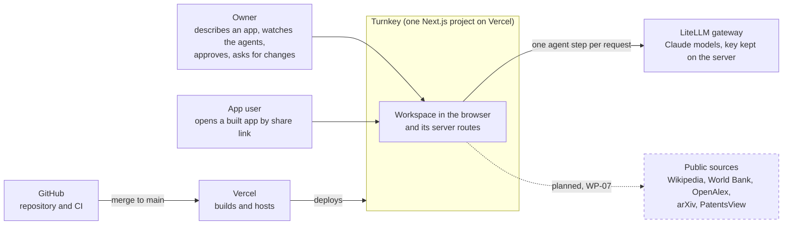
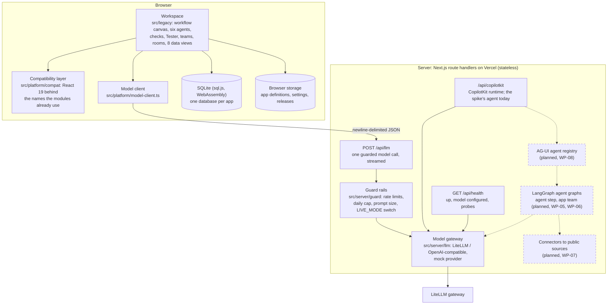
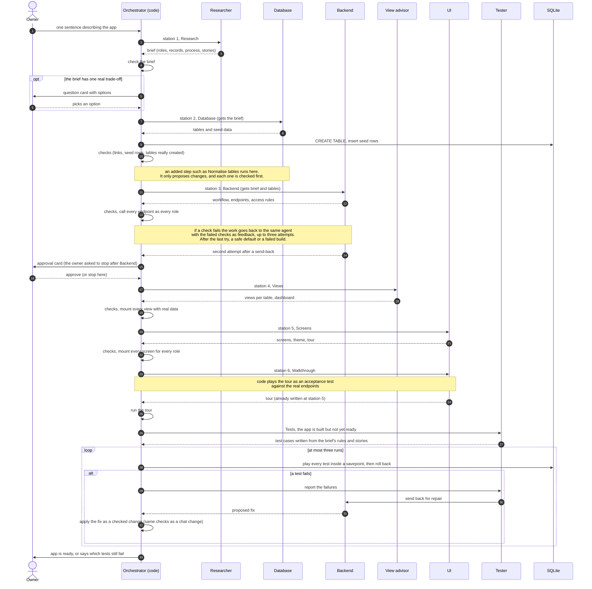
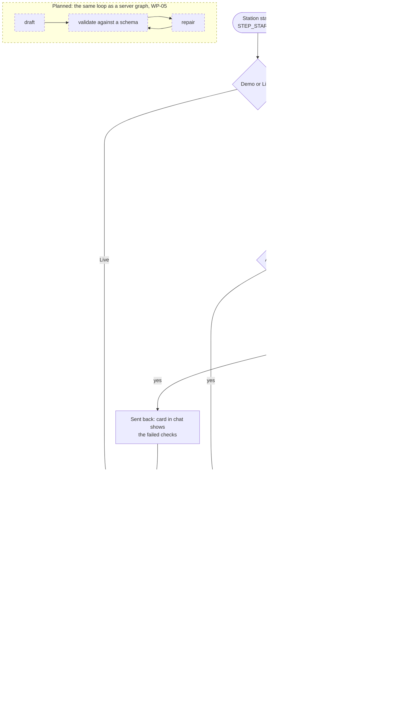
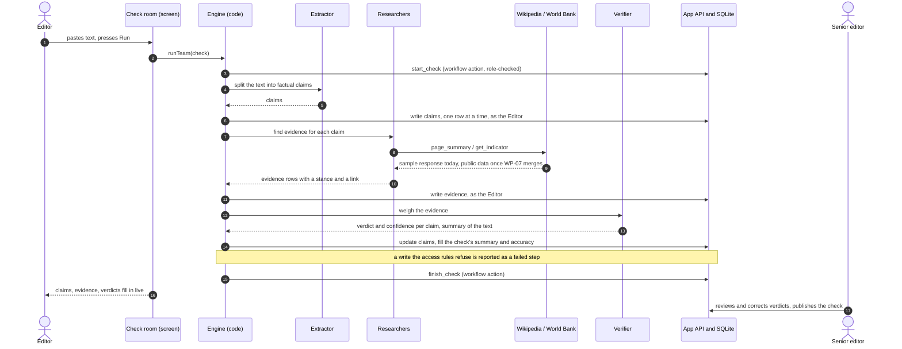
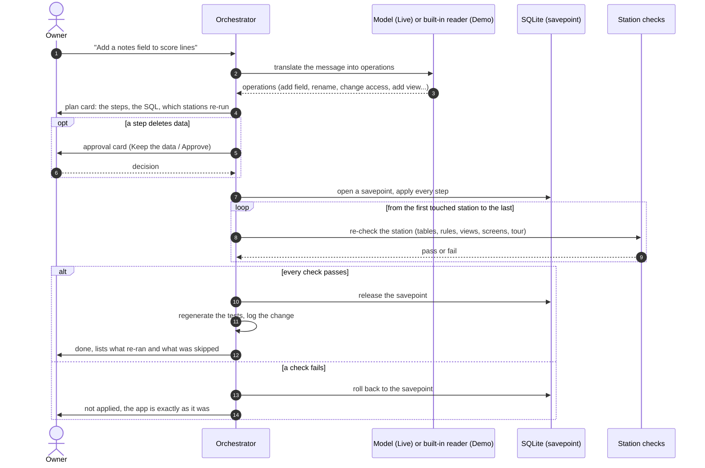
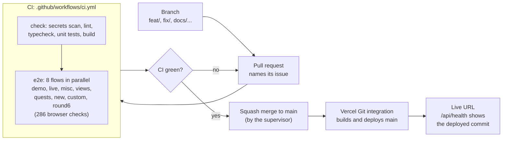
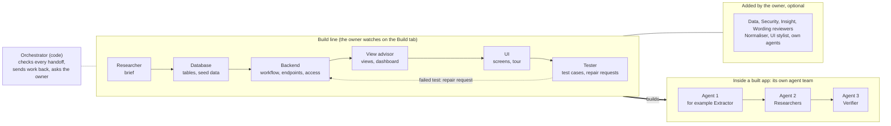

# Architecture overview

This page shows how Turnkey is put together and how its agents work with each other. Every diagram is written in
Mermaid, so GitHub draws it from the text in this file.

**Status words used below.** _Built_ means it is in `main` and covered by the browser checks. _Planned_ means another
work package is building it and it is not merged yet; the work package number (WP-nn) points to its issue. When one
merges, this page is updated in a follow-up pull request. In the diagrams, planned parts have a dashed outline.

Two facts to keep in mind while reading:

- The agents' orchestration (stations, checks, send-backs, approvals, the Tester, app agent teams, changes from chat)
  is built, and runs in the browser from `src/legacy`. The server today holds the model route, the guard rails and
  the health route. The server-side graphs are planned (WP-05, WP-06, WP-08, WP-16).
- Code, not a model, decides whether an agent's answer is good enough. The Orchestrator is code.

Contents: [1 System context](#1-system-context) · [2 Containers](#2-containers) ·
[3 The build workflow](#3-the-build-workflow) · [4 One agent step](#4-one-agent-step) ·
[5 A team run: the fact-check app](#5-a-team-run-the-fact-check-app) · [6 A change from chat](#6-a-change-from-chat) ·
[7 Deployment pipeline](#7-deployment-pipeline) · [8 The agents at a glance](#8-the-agents-at-a-glance)

## 1. System context

Who uses Turnkey and what it talks to.

Notes:

- With no model configured, saved builds and every screen still work (Demo mode). Live mode needs the gateway.
- The public-source connectors are planned (WP-07). Today, the three quest apps show saved sample evidence in Demo,
  and in Live their agents work from what the model knows. The app says so on its About page ("What is real in this
  prototype", `src/legacy/shell-c.js`).

## 2. Containers

What runs where. The browser holds the product and its data. The server is stateless: it relays model calls and
enforces limits.

Rules the layout enforces (also in `CLAUDE.md`): the browser never calls a model provider; nothing in `src/server` is
imported from `src/platform` or `src/legacy`; keys are read only in server code.

Also planned: a storage adapter with IndexedDB (WP-10), an installable app with offline support (WP-11), and the build
workflow compiled to a graph behind a switch (WP-09, wired by WP-16). Until then the classic orchestrator in
`src/legacy/line.js` is the only one.

## 3. The build workflow

One build, from one sentence to a working app. There are five builder agents (Researcher, Database, Backend, View
advisor, UI) and the Tester, which makes six agents with distinct jobs. The Orchestrator is code that runs the
stations in order and checks each handoff (`src/legacy/line.js`, `runBuild` and `runStation`).

The stations, in order: Research, Database, Backend, Views, Screens, Walkthrough, then the Tests step.
The UI agent owns two stations (Screens and Walkthrough). The diagram shows the owner's own steps that the screenshot
in the README shows: an approval gate after Backend and a "Normalise tables" step after Database.

What each step really does, with where to read it:

| Step                                   | What happens                                                                                                                                                                                                                              | Code                                  |
| -------------------------------------- | ----------------------------------------------------------------------------------------------------------------------------------------------------------------------------------------------------------------------------------------- | ------------------------------------- |
| Agents answer in JSON                  | Each agent returns one JSON object. Code validates and normalises it. Nothing a model writes is run as code.                                                                                                                              | `line.js` (`PROMPTS`, `APPLY`)        |
| Check after each station               | `APPLY[station]` returns a list of checks. Examples: the tables were created in SQLite, every endpoint was called as every role, every view and screen drew with real data, the tour passes against the endpoints.                        | `line.js`, `engine.js`, `runtime.js`  |
| Send-back                              | A failed check puts the station in "sent back", posts a card in chat, and runs the agent again with the failed checks in its prompt. At most three attempts (the owner can lower it).                                                     | `line.js`, `runStation`               |
| Safe default                           | After the last attempt, Backend, Views, Screens and Walkthrough fall back to rule-built output that must also pass its checks. Research and Database have no default; if they fail, the build stops and says why.                         | `line.js`, `FALLBACK`                 |
| Approval                               | The owner can ask for a stop after any station. The line waits on an approval card (or the chat words "approve" or "stop").                                                                                                               | `custom.js`, `askGate`                |
| The owner's own steps                  | Four review agents (Data, Security, Insight, Wording), two that apply their own changes (Normaliser, UI stylist), and up to eight added steps in all. Reviewers never stop the line.                                                      | `custom.js`, `REVIEWERS`, `runReview` |
| Tester and repair                      | The Tester writes test cases as data. Code plays them in a savepoint. Failures go to the Backend agent for a repair, which is applied only if it passes the checks. At most three runs. A version can only be released if all tests pass. | `tester.js`, `runTester`              |
| If a run that keeps the database fails | The app goes back exactly as it was.                                                                                                                                                                                                      | `line.js`, `runBuild`                 |

Demo and Live use the same line. In Demo each agent's answer is replayed from a saved build and no model is called. In
Live each agent makes its own model call. The run header shows "N model calls" or "N replayed, 0 model calls".

## 4. One agent step

What one station does for one agent. Today this runs in the browser; the server version as a small LangGraph graph is
planned (WP-05) and is drawn as the dashed part.

Each step emits AG-UI style events (`RUN_STARTED`, `STEP_STARTED`, `TEXT_MESSAGE_*`, `STATE_DELTA`, `STEP_FINISHED`,
`RUN_FINISHED`, and `CUSTOM` for `checks`, `sent_back`, `interrupt`, `resume`). Today they feed the workspace's own
event log and the Debug drawer (Settings, Debug mode). Sending them from the server through the CopilotKit runtime is
planned (WP-08, WP-16).

## 5. A team run: the fact-check app

The apps Turnkey builds can have agents of their own. The Fact-check desk has three: Extractor, Researchers and
Verifier (`src/legacy/quests.js`, `src/legacy/team.js`). The Backend agent writes the team as data. A fixed engine
runs it. Every write goes through the app's own API as the person who pressed Run, so the access rules apply to the
agents too.

The same engine runs the other apps:

| App                | Agents, in order                 | Pause for a person                               | Tools                        |
| ------------------ | -------------------------------- | ------------------------------------------------ | ---------------------------- |
| Fact-check desk    | Extractor, Researchers, Verifier | none                                             | Wikipedia, World Bank        |
| Prior-art scout    | Search, Analyst, Critic          | none                                             | PatentsView, OpenAlex, arXiv |
| Debate partner     | For, Against, Moderator          | before the Moderator: add a point from the floor | none                         |
| Sales bidding desk | Qualifier, Pricing, Red team     | before the Red team: add a risk or a condition   | none                         |

Each agent answers one JSON object. Each is limited to what the team definition lets it write. A run can be stopped. In
Demo the run replays a saved script, and the tool calls are recorded samples; in Live every agent makes its own model
call (`teamLive`, one retry if the answer is not usable).

The planned server version (WP-06) compiles the same team definition to a LangGraph graph with a checking agent that
can send work back once.

## 6. A change from chat

The owner types a change into the chat sidebar. Only the stations the change touches run again (`src/legacy/changes.js`,
`handleChat`, `runChange`, `applyChangeSync`).

The Tester's repair (section 3) goes through the same path: a repair is a change request that has to pass the same
checks.

## 7. Deployment pipeline

Only `main` deploys. Other branches do not (`vercel.json`), because the free plan allows a limited number of
deployments a day and several agents push at once.

Secrets: the model key lives only in Vercel's environment variables (and `.env.local` locally,
which git ignores). `npm run check:secrets` runs in CI. Nothing starts with `NEXT_PUBLIC_`.

## 8. The agents at a glance

Which agents exist, what they write, and who checks them.

