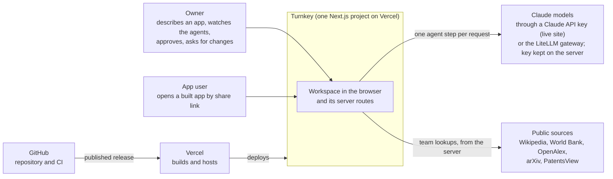
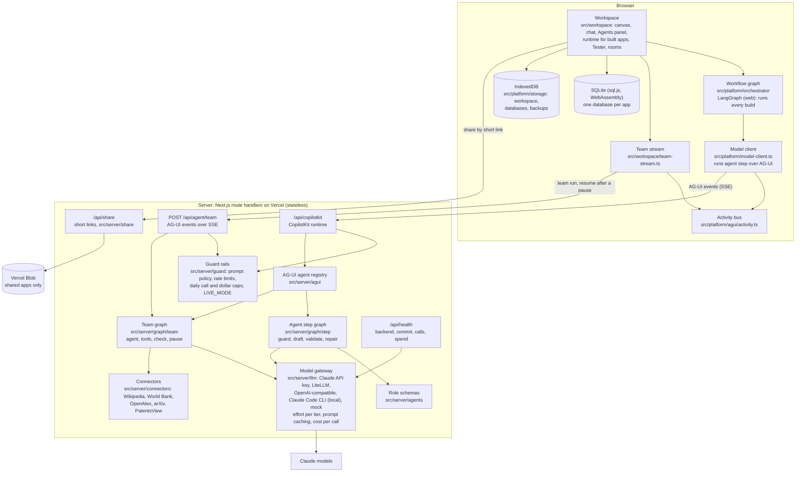
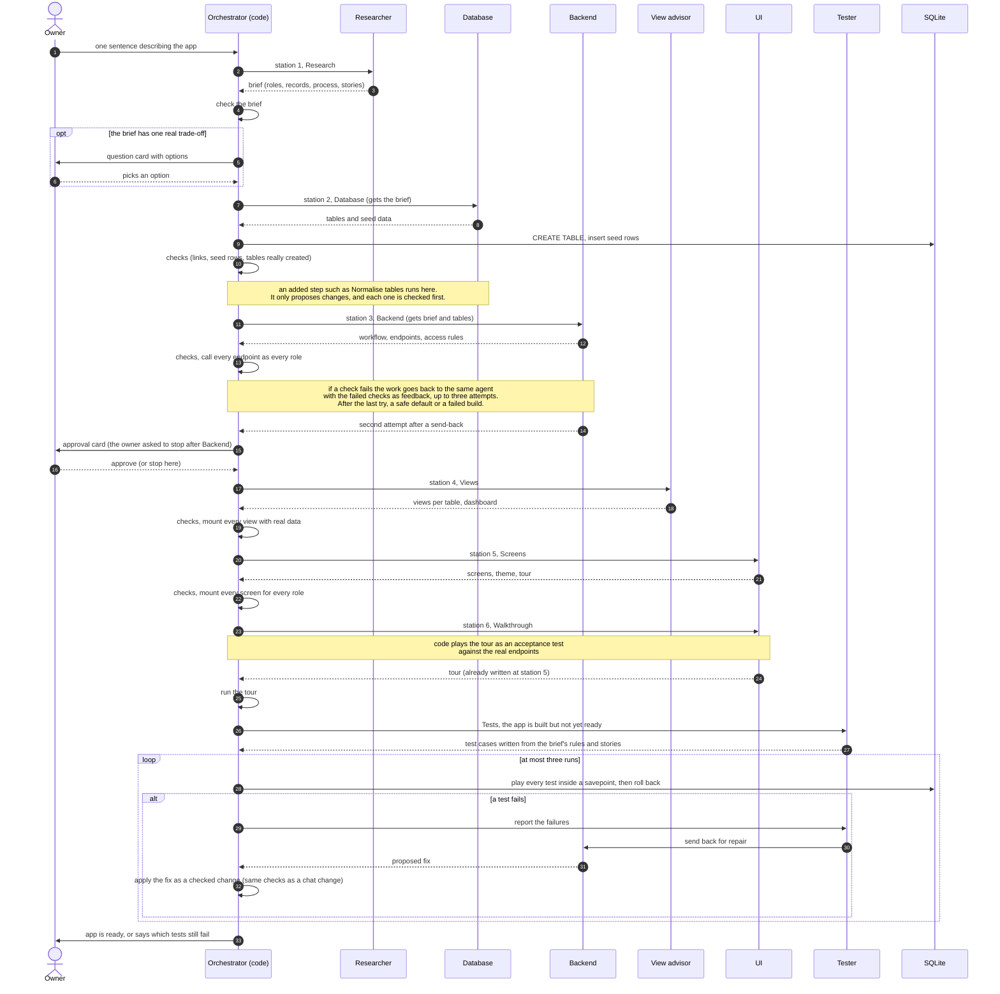
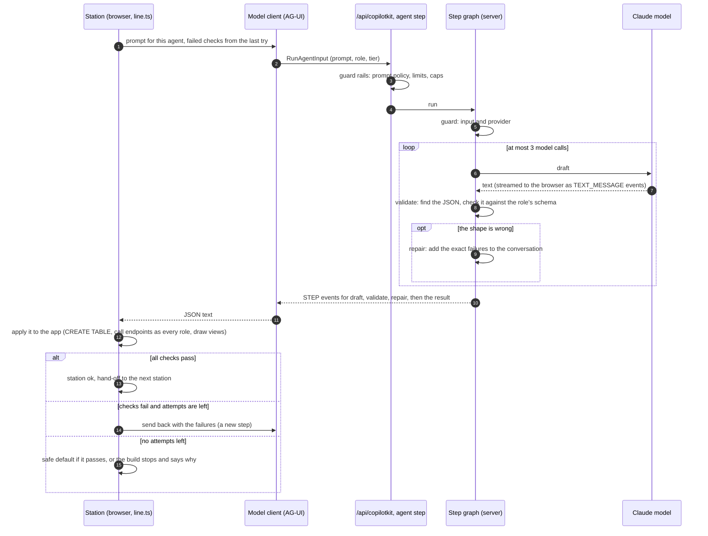
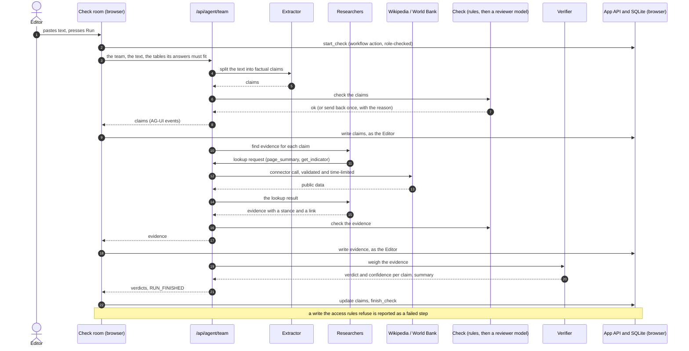
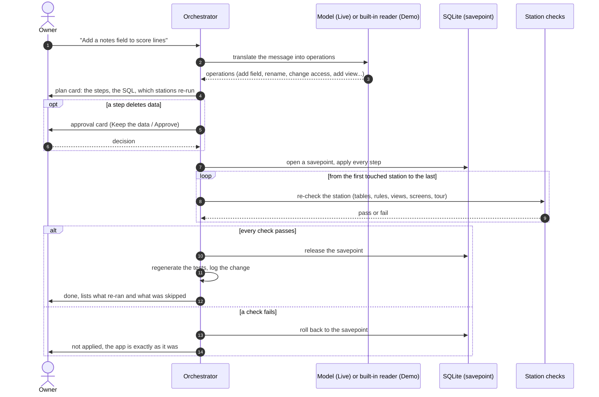
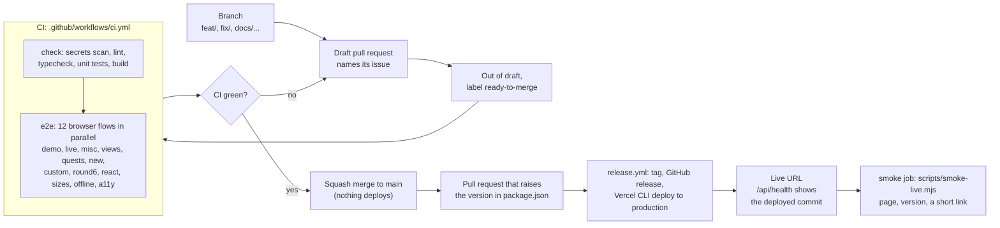
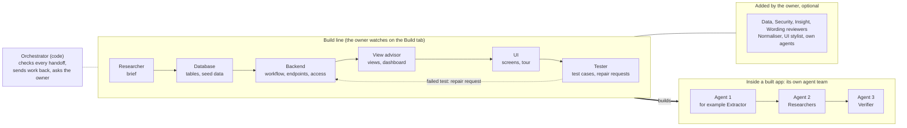
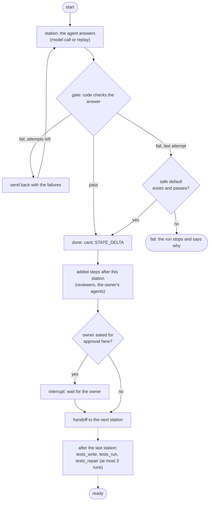
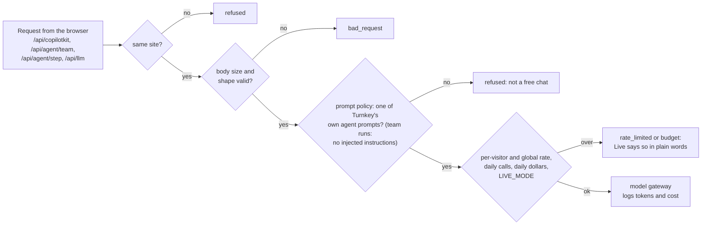

# Architecture overview

This page shows how Turnkey is put together and how its agents work with each other. Every diagram is written in
Mermaid, so GitHub draws it from the text in this file.

**Status words used below.** _Built_ means it is in `main` and covered by tests. Everything on this page is built
unless it says _planned_. Updated 26 Nov 2026, after release v0.3.2.

Three facts to keep in mind while reading:

- The build is driven from the browser. The owner's workflow is compiled into a LangGraph graph
  (`src/platform/orchestrator`) that decides the order: stations, checks, send-backs, approvals, added steps, the
  Tester. The app's database lives in the browser too, so code there applies and checks each answer.
- In Live, every agent's turn runs on the server: the browser asks agent `step` in the CopilotKit runtime over AG-UI,
  and the server runs one small LangGraph graph (draft, validate against the role's schema, repair). An app's own
  agent team runs on the server as a LangGraph graph of its own, with lookups in public sources. In Demo, saved answers
  are replayed through the same path and no model is called.
- Code, not a model, decides whether an agent's answer is good enough.

Contents: [1 System context](#1-system-context) · [2 Containers](#2-containers) ·
[3 The build workflow](#3-the-build-workflow) · [4 One agent step](#4-one-agent-step) ·
[5 A team run: the fact-check app](#5-a-team-run-the-fact-check-app) · [6 A change from chat](#6-a-change-from-chat) ·
[7 Deployment pipeline](#7-deployment-pipeline) · [8 The agents at a glance](#8-the-agents-at-a-glance) ·
[9 The workflow as a graph](#9-the-workflow-as-a-graph) ·
[10 Guard rails on every model call](#10-guard-rails-on-every-model-call)

## 1. System context

Who uses Turnkey and what it talks to.

Notes:

- With no model configured, saved builds and every screen still work (Demo mode). Live mode needs the gateway.
- In Live, an app's team agents look up public sources from the server (`src/server/graph/team/connector-tools.ts`
  over `src/server/connectors`). In Demo, the quest apps replay saved runs whose evidence is marked as sample data.
  The app says so on its About page ("What is real in this prototype").
- On the live site the model is reached with a Claude API key. The hackathon's LiteLLM gateway is supported by the
  same gateway code and switched on by environment variables (`src/server/llm/README.md`); the owner chose the API key
  on 26 Nov.

## 2. Containers

What runs where. The browser holds the product and its data. The server is stateless: it relays model calls and
enforces limits.

Rules the layout enforces (also in `CLAUDE.md`): the browser never calls a model provider; nothing in `src/server` is
imported from `src/platform` or `src/workspace`; keys are read only in server code. `/api/llm` (one guarded model call)
and `/api/agent/step` (the step graph over plain HTTP) still exist beside the AG-UI route; the workspace uses the AG-UI
route.

The data model, storage and export are described in [`data.md`](data.md); the AG-UI events in [`ag-ui.md`](ag-ui.md).

## 3. The build workflow

One build, from one sentence to a working app. There are five builder agents (Researcher, Database, Backend, View
advisor, UI) and the Tester, which makes six agents with distinct jobs. The Orchestrator is code: `runBuild` in
`src/workspace/line.ts` compiles the owner's workflow into a LangGraph graph (`createRun`, `workflowFromFlow` from
`src/platform/orchestrator`) and gives it ports that run each station, ask the owner and run the Tester. Section 9
shows the graph.

The stations, in order: Research, Database, Backend, Views, Screens, Walkthrough, then the Tests step.
The UI agent owns two stations (Screens and Walkthrough). The diagram shows the owner's own steps that the screenshot
in the README shows: an approval gate after Backend and a "Normalise tables" step after Database.

What each step really does, with where to read it:

| Step                                   | What happens                                                                                                                                                                                                                              | Code                                   |
| -------------------------------------- | ----------------------------------------------------------------------------------------------------------------------------------------------------------------------------------------------------------------------------------------- | -------------------------------------- |
| Agents answer in JSON                  | Each agent returns one JSON object. Code validates and normalises it. Nothing a model writes is run as code.                                                                                                                              | `line.ts` (`PROMPTS`, `APPLY`)         |
| Check after each station               | `APPLY[station]` returns a list of checks. Examples: the tables were created in SQLite, every endpoint was called as every role, every view and screen drew with real data, the tour passes against the endpoints.                        | `line.ts`, `engine.tsx`, `runtime.tsx` |
| Send-back                              | A failed check puts the station in "sent back", posts a card in chat, and runs the agent again with the failed checks in its prompt. At most three attempts (the owner can lower it).                                                     | `line.ts`, `runStation`                |
| Safe default                           | After the last attempt, Backend, Views, Screens and Walkthrough fall back to rule-built output that must also pass its checks. Research and Database have no default; if they fail, the build stops and says why.                         | `line.ts`, `FALLBACK`                  |
| Approval                               | The owner can ask for a stop after any station. The line waits on an approval card (or the chat words "approve" or "stop").                                                                                                               | `custom.tsx`, `askGate`                |
| The owner's own steps                  | Four review agents (Data, Security, Insight, Wording), two that apply their own changes (Normaliser, UI stylist), and up to eight added steps in all. Reviewers never stop the line.                                                      | `custom.tsx`, `REVIEWERS`, `runReview` |
| Tester and repair                      | The Tester writes test cases as data. Code plays them in a savepoint. Failures go to the Backend agent for a repair, which is applied only if it passes the checks. At most three runs. A version can only be released if all tests pass. | `tester.tsx`, `runTester`              |
| If a run that keeps the database fails | The app goes back exactly as it was.                                                                                                                                                                                                      | `line.ts`, `runBuild`                  |

Demo and Live use the same line. In Demo each agent's answer is replayed from a saved build and no model is called. In
Live each agent's turn runs on the server step graph (section 4). The run header shows "N model calls" or "N replayed, 0 model calls".

## 4. One agent step

What one station does for one agent in Live. The browser builds the prompt and owns the checks that need the app's
database; the server runs the model and checks the shape of the answer against the role's schema before it comes back.

So an answer is checked twice: once on the server for its shape (`src/server/graph/step/graph.ts`, schemas in
`src/server/agents/schemas.ts`), once in the browser for what it does to the real app (`APPLY` in `line.ts`). Each
model call on the server goes through the gateway, which sets the effort for the tier (Sonnet at medium for building
roles, Haiku at low for quick ones), marks the stable prompt for caching and logs tokens and cost.

Every step is an AG-UI event (`RUN_STARTED`, `STEP_STARTED`, `TEXT_MESSAGE_*`, `STATE_DELTA`, `STEP_FINISHED`,
`RUN_FINISHED`, and `CUSTOM` for `checks`, `sent_back`, `interrupt`, `resume`). The canvas, the timeline, the log, the
Agents panel (`src/workspace/activity.tsx`) and debug mode all read them. Details: [`ag-ui.md`](ag-ui.md).

## 5. A team run: the fact-check app

The apps Turnkey builds can have agents of their own. The Fact-check desk has three: Extractor, Researchers and
Verifier (`src/workspace/quests.ts`). The Backend agent writes the team as data. In Live the server compiles it into a
LangGraph graph (`src/server/graph/team`) and streams AG-UI events back; the browser owns the app's database, so each
accepted answer is written there through the app's own API as the person who pressed Run, and the access rules apply
to the agents too (`src/workspace/team.tsx`).

The same graph runs the other teams:

| App                | Agents, in order                         | Pause for a person                               | Tools                        |
| ------------------ | ---------------------------------------- | ------------------------------------------------ | ---------------------------- |
| Fact-check desk    | Extractor, Researchers, Verifier         | none                                             | Wikipedia, World Bank        |
| Prior-art scout    | Search, Analyst, Critic                  | none                                             | PatentsView, OpenAlex, arXiv |
| Debate partner     | For, Against, Moderator                  | before the Moderator: add a point from the floor | none                         |
| Sales bidding desk | Qualifier, Pricing, Red team             | before the Red team: add a risk or a condition   | none                         |
| Grant review desk  | Assessor, Budget reviewer, Due diligence | before Due diligence: add a condition            | none                         |

Each agent answers one JSON object and may write only what the team definition lets it. A pause ends the request with
a snapshot; the person's note and the snapshot start a second request that resumes the run. Caps are part of the
graph's state (model calls, tool calls, one send-back per agent), and every run passes through a `finish` node, whether
it completed or hit a cap. In Demo the run replays a saved script and its lookups are recorded samples.

## 6. A change from chat

The owner types a change into the chat sidebar. Only the stations the change touches run again (`src/workspace/changes.ts`,
`handleChat`, `runChange`, `applyChangeSync`).

The Tester's repair (section 3) goes through the same path: a repair is a change request that has to pass the same
checks.

## 7. Deployment pipeline

Merging does not deploy. Vercel's Git integration is off (`vercel.json`), and production is deployed only by a release
(`.github/workflows/release.yml`). CI runs only on a pull request that is out of draft and labelled `ready-to-merge`,
to save Actions minutes while many agents push at once. Details: [`docs/process/deploy.md`](../process/deploy.md).

Secrets: the model key lives only in Vercel's environment variables (and `.env.local` locally,
which git ignores). `npm run check:secrets` runs in CI. Nothing starts with `NEXT_PUBLIC_`.

## 8. The agents at a glance

Which agents exist, what they write, and who checks them.

## 9. The workflow as a graph

The workflow the owner edits on the canvas compiles into a LangGraph graph that runs in the browser
(`@langchain/langgraph/web`, `src/platform/orchestrator`, `compileWorkflow` and `createRun`), and every build runs
through it. Approvals and the Researcher's question are LangGraph interrupts; the owner's answer resumes the run.
When the owner edits the workflow of a built app, only the stations the edit touches run again, after a short pause
that gathers a burst of edits into one run; a re-run that would rebuild the database asks first
(`src/workspace/rerun.tsx`). Below is the shape for one station. Every station repeats it; Research adds the question
to the owner, and stations that have a safe default add a fallback node.

The full generated graph for the default workflow, with every node, is in
[`src/platform/orchestrator/default-workflow.mmd`](../../src/platform/orchestrator/default-workflow.mmd)
(`node src/platform/orchestrator/scripts/print-mermaid.mjs` prints it again).

## 10. Guard rails on every model call

The app is public, has no login, and the model budget is small. Every route that can spend it passes the same checks
first (`src/server/guard`), and the workspace adds its own per-session cap.

Defaults: 20 calls per visitor and 50 for everyone per minute, 600 calls and 5 dollars a day, prompts up to 120,000
characters, answers up to 8,000 tokens (`src/server/guard/limits.ts`). The workspace stops a Live session after 40
model calls (`CAP` in `src/workspace/core.ts`). Counters live in each server instance's memory, so they are a brake;
the provider's own budget is the hard stop.
