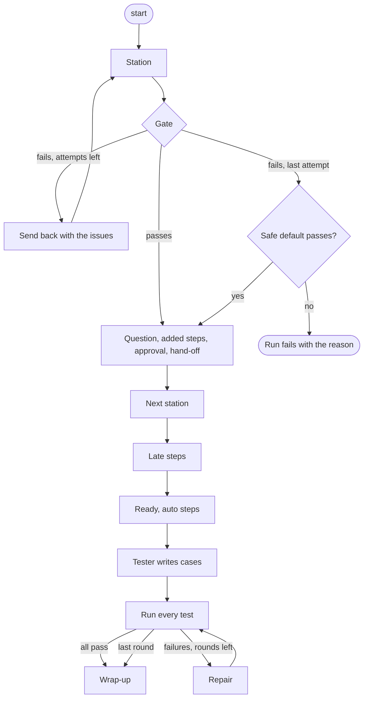

# Workflow graph (WP-09)

The build workflow the owner sees and edits on the canvas, as a LangGraph graph compiled from the workflow
definition. A library: nothing here touches the workspace. The classic loop (`runBuild` in
`src/workspace/line.ts`) stays the default. Integration wires this in later behind a switch.

This file has two parts: first the **specification**, the exact order of events in a build as the classic loop does it
today; then how the graph reproduces it.

## 1. Specification: the order of events in a build

Sources: `src/workspace/line.ts` (`runBuild`, `runStation`, `askQuestion`), `src/workspace/custom.tsx` (`flowOf`, `stepsAt`,
`stepAfter`, `stepAuto`, `askGate`, `runReview`, `applyAuto`), `src/workspace/tester.tsx` (`runTester`).

### 1.1 The workflow as data

`flowOf(app)` holds the owner's choices; `normFlow` makes them valid.

| Field        | Meaning                                                                                                                   |
| ------------ | ------------------------------------------------------------------------------------------------------------------------- |
| `attempts`   | 1 to 3, default 3. How many times a station may try before it fails.                                                      |
| `approve`    | stations after which the line stops for the owner. Allowed: research, database, backend, views, screens.                  |
| `by`         | `rules` for a station the owner gave to code (no agent, no model). Allowed: backend, views, screens, walkthrough.         |
| `reviewers`  | added steps (library reviewers or the owner's own agents), sorted by the station they follow, then by the order added.    |
| `at`, `auto` | where a step sits (after database, backend, views, screens or walkthrough) and whether it applies its changes or advises. |
| `notes`      | standing instructions per agent. They change prompts only, not the order of events, so the graph ignores them.            |

The six stations, in order: Research, Database, Backend, Views, Screens, Walkthrough. Agents: researcher, database,
backend, views, ui (Screens and Walkthrough).

### 1.2 A build, step by step

`runBuild(app, from)`. `from` is a station id: a partial run starts there and keeps the stations before it.

1. **Start.** Create the run. `RUN_STARTED`. A full build also sends `STATE_SNAPSHOT` and resets the app. The orchestrator
   says what is about to happen. Wait 600 ms. If the run reaches the database, drop the old database.
2. **For each station from the start station, in order**, `runStation`:
   1. `STEP_STARTED` with the station id.
   2. **Attempts loop**, `max = flow.attempts`.
      - If the station is `by: rules`: one pass with the built-in rules (step "Built-in rules", then step "Checks"). No
        model call. If the checks fail, the run fails at once with "`<Station>` could not be built by the rules. `<first issue>`".
        There is no send-back and no fallback.
      - Otherwise, for `attempt = 1..max`: step "Model call" / "Replay" (attempt 1), "Retry n" (later), or "Tour handed
        over" (Walkthrough, attempt 1). The agent produces output. If producing fails with an error that is not a stop or
        a fatal one, that becomes a failed check ("The answer was not usable") and the loop goes on. Then step
        "Checks": code applies the output and returns checks. With fewer than three attempts the last attempt is
        checked as it stands first, then once more with code repair on the same answer.
      - `CUSTOM checks {station, attempt, passed, failed}`.
      - No issues: leave the loop.
      - Issues and attempts left: this is a **send-back**. `retries++`, orchestrator says so with a "sentback" card,
        `CUSTOM sent_back {station, attempt, issues}`, wait 1100 ms, the next attempt gets the issues as feedback.
      - Issues on the last attempt: use the station's **safe default** (`FALLBACK`: backend, views, screens, walkthrough;
        not research or database) if it passes its checks. Otherwise the station is `failed` and the run fails with
        "`<Station>` did not pass its checks after `<n>` attempts. `<first issue>`".
   3. The station is `ok`. `STATE_DELTA`, the agent says what it made and shows its card, `STEP_FINISHED`.
   4. **Research only:** if the brief has a question and the owner has not answered it, ask it. `CUSTOM interrupt
{reason: question}`, the run waits. The answer resumes it: `CUSTOM resume {answer}`. The decision is written
      into the brief.
   5. **Added steps after this station**, in order (`stepsAt`). Each is `runReview`: `STEP_STARTED review_<id>`, one
      step in the run, findings, `STATE_DELTA`, `STEP_FINISHED review_<id>`. A step never stops the line.
   6. **Approval**, if the owner asked for one after this station: `CUSTOM interrupt {reason: approval, station}`, the
      run waits. Approve: `CUSTOM resume {approved: true}` and the line goes on. Stop: `resume {approved: false}` and the
      run is stopped.
   7. **Hand-off** (every station except Walkthrough): short pause, the next station lights up.
3. **Steps that were added after their station had already passed** and have no review yet run now, in order.
4. **Ready.** If the app has its own agent team, switch on the connections it needs. `status = ready`. `applyAuto`:
   steps set to apply push their proposed changes through the checked change pipeline.
5. **Tester**, `runTester`:
   1. `STEP_STARTED tests`. Step "Write test cases" (model or rules).
   2. **Rounds**, `n = 1..testerMax` (the step's rounds setting, 1 to 3, default 3: one run and at most two repair rounds):
      - Step "Run every test" (first) or "Run every test again". Count the failures.
      - No failures, or `n` is the last round: stop looping.
      - Otherwise send the failures back: `retries++`, step "Repair". The Backend agent (model) or the rules propose
        changes. Each is applied as a checked change. Cases that contradict the brief may be withdrawn instead.
      - If nothing could be repaired or withdrawn: stop looping.
   3. The result is `ok` or `failed`. Failed tests do **not** fail the run: the app works, a version just cannot be
      released. `STEP_FINISHED tests`.
6. **Wrap-up.** `run.status = ok`. Reviews are re-stamped and each proposed fix is tried in a savepoint
   (`verifyFindings`). The orchestrator says the app is ready. `RUN_FINISHED`.

### 1.3 Ending early

- **Stop** (`stopRun`): `Stopped` is thrown from wherever the run is, including a wait for the owner. The run is
  `stopped`, stations that are not `ok` go back to `idle`. A stopped partial run restores the app as it was. A stopped
  full run does not.
- **Fatal error** (no model, offline, call cap, rate limit): the run fails with the message. `RUN_ERROR`.
- **Failed station**: as above. `RUN_ERROR`, stations that were working or waiting become `failed`.
- Always: `RUN_FINISHED {status}`.

### 1.4 Event names the workspace logs

| Event                                                       | When                                                   |
| ----------------------------------------------------------- | ------------------------------------------------------ |
| `RUN_STARTED`, `RUN_FINISHED`, `RUN_ERROR`                  | run start, end (always), failure                       |
| `STATE_SNAPSHOT`, `STATE_DELTA`                             | start of a full build; when a station or step produces |
| `STEP_STARTED`, `STEP_FINISHED` with `stepName`             | station id, `review_<id>`, `tests`                     |
| `CUSTOM` named `checks`, `sent_back`, `interrupt`, `resume` | gate result, send-back, wait for the owner, answer     |
| `TEXT_MESSAGE_*`, tool calls                                | what agents say; owned by the ports, not the graph     |

Run steps (`run.steps`, the timeline) carry `{station, agent, label, kind}`: kinds `model`, `tool`, `check`, `wait`.

## 2. How the graph reproduces it

`compileWorkflow(definition, ports)` returns a compiled LangGraph graph (with an in-memory checkpointer, which
interrupts need). `startRun(...)` in `run.ts` drives it: start, resume with the owner's answer, stop.

### 2.1 Nodes and edges

For each station `x` the compiler makes:

| Node          | Does                                                                                              |
| ------------- | ------------------------------------------------------------------------------------------------- |
| `x`           | `STEP_STARTED` on the first attempt, then `ports.runStation` for this attempt, with the feedback. |
| `x:gate`      | `ports.runGate`; emits `CUSTOM checks`; writes `{ok, issues}` to state.                           |
| `x:sendback`  | `retries++`, `ports.sentBack`, `CUSTOM sent_back`. Goes back to `x` with the issues.              |
| `x:fallback`  | only for stations with a safe default: `ports.fallback`.                                          |
| `x:fail`      | sets `status = failed` and the reason. Goes to the end.                                           |
| `x:done`      | `ports.stationDone`, `STEP_FINISHED`.                                                             |
| `x:ask`       | Research only: `ports.owner.question`, kept in state. Safe to run twice.                          |
| `x:answer`    | Research only: if there is a question, **interrupt**; then `ports.owner.answered`.                |
| `x:step:<id>` | one per added step after this station: `ports.runStep`.                                           |
| `x:approve`   | only if approved here: **interrupt**; then `ports.owner.decided`. A "no" ends the run as stopped. |
| `x:handoff`   | `ports.handoff` (not after Walkthrough).                                                          |

The gate is a **conditional edge** out of `x:gate`: pass goes to `x:done`; fail with attempts left goes to
`x:sendback`; fail on the last attempt goes to `x:fallback` (if the station has one) or `x:fail`. A station given to
code has one attempt and no fallback.

After the last station: `late-steps`, `ready`, then the Tester: `tests:write`, `tests:run`, a conditional edge (all pass
or last round: `tests:done`; failures and rounds left: `tests:repair`, which goes back to `tests:run`; nothing repaired:
`tests:done`), `tests:done`, `wrapup`, end.

A partial run (`definition.from`) starts at that station: the edge out of START points there.

### 2.2 Ports

Nodes know nothing of the workspace. Everything they do goes through `ports` (see `types.ts`): `runStation`, `runGate`,
`fallback`, `sentBack`, `stationDone`, `handoff`, `runStep`, `lateSteps`, `owner.question/answered/decided`, `ready`,
`tester.write/run/repair/done`, `wrapUp`, `emit`. Nodes emit the orchestration events themselves through `ports.emit`, using
the names in 1.4, so the canvas and timeline can follow a graph run.

### 2.3 Rules the code follows

- A node name must not equal a state key (LangGraph refuses). Station nodes are named `st_<id>`, `st_<id>_gate`, and so on.
  The table above uses `x:` as shorthand for that prefix.
- Interrupts re-run their node from the top when resumed. So a node that interrupts does nothing before the interrupt
  that must not happen twice, and calls `interrupt()` before its first `await` (the browser stand-in for async context in
  `browser-context.ts` only holds across the synchronous part of a call).
- Thrown errors leave the graph: the driver turns them into `failed` or `stopped`. A station that fails its gate is not an
  error, it is a result.
- Every loop is capped: attempts at most 3, Tester rounds at most 3, and LangGraph's own recursion limit is set.

### 2.4 Mermaid

`node src/platform/orchestrator/scripts/print-mermaid.mjs` prints the compiled default workflow. The current output is in
`default-workflow.mmd`; a test checks it still matches.



## 3. Wiring it in (for integration)

Server-free, browser-safe. Everything below uses names that exist in `src/workspace` after the move out of `src/legacy`.

```ts
import { createRun, workflowFromFlow } from '@/platform/orchestrator';
import { flowOf, REVIEWERS } from '@/workspace/custom';

const def = workflowFromFlow(flowOf(app), (id) => REVIEWERS[id], from); // `from` only for a partial run
const run = createRun(def, ports, { app: app.id, runId: run.id });
let r = await run.start(); // r.status: ok | failed | stopped | waiting
while (r.status === 'waiting') r = await run.resume(answerFromOwner(r.ask)); // question: {index}, approval: {approved}
```

| Port                      | Map it to                                                                                       |
| ------------------------- | ----------------------------------------------------------------------------------------------- |
| `runStation`              | the attempt body of `runStation` in `line.ts` (`produce`, then `APPLY`), `feedback` as `fbText` |
| `runGate`                 | the checks `runStation` runs after `APPLY`, including the repair pass on the last attempt       |
| `fallback`                | `FALLBACK[station.id]` followed by the same checks                                              |
| `sentBack`                | the "sentback" card, `run.retries++`, the 1100 ms pause (`pace`)                                |
| `stationDone`             | the `ok` bookkeeping, `DONE_SAY` and `CARD` for the station                                     |
| `owner.question/answered` | `askQuestion` and `answerQuestion` (the graph does the waiting; ports must not block)           |
| `owner.decided`           | the effect of `answerGate(app, ok)`                                                             |
| `runStep`                 | `runReview` in `custom.tsx`                                                                     |
| `ready`, `tester.*`       | the ready block of `runBuild`, then `runTester` split into write, run, repair and done          |
| `stopped`                 | `() => run.stopped` (set by `stopRun`)                                                          |
| `emit`                    | `log(app, type, payload)`, the same events the timeline already shows                           |

An approval does not need `askGate`'s promise: the graph stops with `status: 'waiting'` and `ask`, and the Approve and
Stop buttons call `run.resume({ approved })`. The same holds for the Researcher's question (`resume({ index })`).
